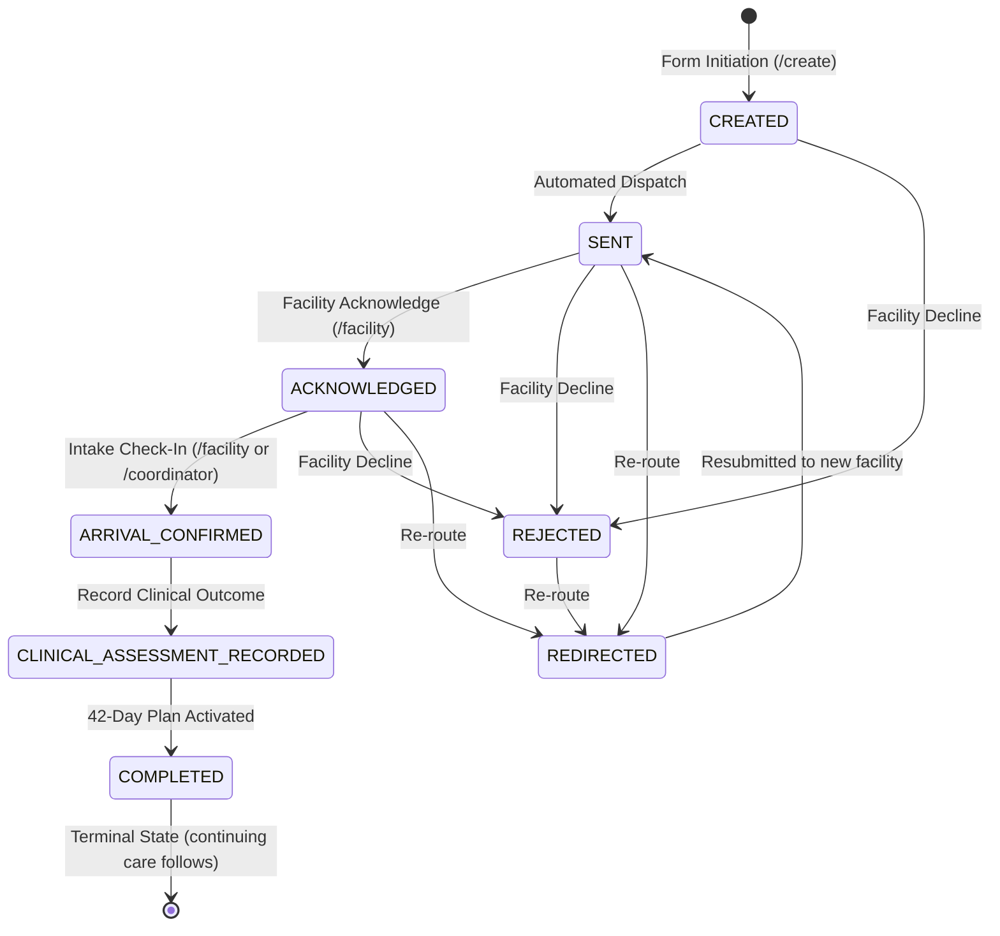

# Navexa Health — Referral Lifecycle & Workflow Audit

**Document:** `docs/REFERRAL_LIFECYCLE_AUDIT.md`  
**Version:** 2.0.0  
**Audit Date:** November 01, 2026  
**Auditor:** Maternal & Neonatal Healthcare Workflow Specialist & Software Architect

---

## 1. Complete Referral State Machine

> **Note:** the diagram above shows the current rules in `src/domain/transitions.js`. The stage-by-stage audit below is a snapshot from before later fixes, so its file citations and gaps may be out of date.

---

## 2. 19-Stage Lifecycle Stage-by-Stage Audit

### Stage 1: Patient Registration & Identification

- **Implementation Status:** `PARTIALLY IMPLEMENTED`
- **File Citations:** [`src/pages/CreateReferral.jsx:16-17`](file:///d:/ANTIGRAVITY/Healthathon/health-a-thon/src/pages/CreateReferral.jsx#L16-L17), [`src/data/demoReferral.js:4-5`](file:///d:/ANTIGRAVITY/Healthathon/health-a-thon/src/data/demoReferral.js#L4-L5)
- **Actual Functionality:** Form generates a pseudo-random MRN (`MRN-XXXXXX`) or allows manual entry. Demo data includes medical record numbers (e.g., `MRN-882104`, `MRN-904211`).
- **Missing Functionality:** No Master Patient Index (MPI), national health identifier lookup, or biometric patient identity matching. Duplicate patients can be created without warning.
- **Data Required:** Full Name, DOB, National Health ID / MRN, Phone Number, Residential Address.
- **Responsible Role:** Referring Healthcare Facility (Intake Clerk / Nurse).
- **Failure Scenarios:** Patient has no ID documents, patient name is misspelled across clinics, duplicate records created for same pregnancy.

### Stage 2: Referral Creation

- **Implementation Status:** `IMPLEMENTED`
- **File Citations:** [`src/pages/CreateReferral.jsx:45-101`](file:///d:/ANTIGRAVITY/Healthathon/health-a-thon/src/pages/CreateReferral.jsx#L45-L101)
- **Actual Functionality:** 4-step wizard captures patient demographics, obstetric context (gravida, para, gestational age), clinical indication, receiving hospital, and social barriers.
- **Missing Functionality:** No validation to prevent referring to the same hospital or department. No attachment support for lab results, ultrasound images, or partograph records.
- **Data Required:** Referring clinician, source clinic, target department, indication narrative.
- **Responsible Role:** Referring Healthcare Facility (Doctor, Certified Nurse Midwife).
- **Failure Scenarios:** Incomplete clinical narrative entered, incorrect receiving hospital selected.

### Stage 3: Clinical Urgency Classification

- **Implementation Status:** `PARTIALLY IMPLEMENTED`
- **File Citations:** [`src/pages/CreateReferral.jsx:11, 58-59`](file:///d:/ANTIGRAVITY/Healthathon/health-a-thon/src/pages/CreateReferral.jsx#L11#L58-L59)
- **Actual Functionality:** Captures ROUTINE, URGENT, and STAT triage priorities. Urgency renders as color-coded badges in queues.
- **Missing Functionality:** Urgency does not trigger automated priority escalation, expedited hospital notification, or ambulance dispatch. All priorities follow the exact same asynchronous queue.
- **Data Required:** Triage level, maternal-fetal acuity indicators (BP, fetal heart rate, membrane status).
- **Responsible Role:** Authorized Clinician (MD, MS OBG).
- **Failure Scenarios:** Non-clinical personnel misclassifying an emergency as routine; critical cases sitting unacknowledged in general queue.

### Stage 4: Referral Submission

- **Implementation Status:** `IMPLEMENTED`
- **File Citations:** [`src/pages/CreateReferral.jsx:94-101`](file:///d:/ANTIGRAVITY/Healthathon/health-a-thon/src/pages/CreateReferral.jsx#L94-L101)
- **Actual Functionality:** Adds referral to context array, sets initial status to `SENT`, adds `CREATED` and `SENT` timeline events, and redirects to `/referral/:id`.
- **Missing Functionality:** No server transmission, delivery receipt acknowledgement, or HL7 FHIR bundle generation.
- **Data Required:** Complete serialized referral payload.
- **Responsible Role:** Referring Healthcare Facility.
- **Failure Scenarios:** Browser closes before submit completes, local storage quota exceeded.

### Stage 5: Receiving Facility Acknowledgement

- **Implementation Status:** `IMPLEMENTED`
- **File Citations:** [`src/pages/FacilityDashboard.jsx:63-70`](file:///d:/ANTIGRAVITY/Healthathon/health-a-thon/src/pages/FacilityDashboard.jsx#L63-L70)
- **Actual Functionality:** Receiving facility clicks "Acknowledge Intake" on incoming card, advancing status from `SENT` to `ACKNOWLEDGED` and appending timeline note.
- **Missing Functionality:** No acknowledgement countdown timer or SLA deadline warning.
- **Data Required:** Facility user ID, intake bed assignment.
- **Responsible Role:** Receiving Healthcare Facility (Triage Nurse / Intake Clerk).
- **Failure Scenarios:** Receiving facility is overwhelmed and fails to check queue; patient arrives before facility acknowledges referral.

### Stage 6: Referral Acceptance, Rejection, or Redirection

- **Implementation Status:** `BROKEN / PARTIALLY IMPLEMENTED`
- **File Citations:** [`src/pages/FacilityDashboard.jsx:62-97`](file:///d:/ANTIGRAVITY/Healthathon/health-a-thon/src/pages/FacilityDashboard.jsx#L62-L97)
- **Actual Functionality:** System only supports acceptance (via acknowledgement).
- **Missing Functionality:** **Rejection and Redirection are completely ABSENT.** If a hospital has no open NICU beds or surgical capacity, there is no button or workflow to reject or re-route the patient to another regional hospital.
- **Data Required:** Acceptance flag, rejection reason code, redirect destination facility.
- **Responsible Role:** Receiving Healthcare Facility.
- **Failure Scenarios:** Hospital has zero beds available; patient sent to wrong facility with no digital redirection protocol.

### Stage 7: Patient & Caregiver Notification

- **Implementation Status:** `SIMULATED`
- **File Citations:** [`src/components/TopHeader.jsx:94`](file:///d:/ANTIGRAVITY/Healthathon/health-a-thon/src/components/TopHeader.jsx#L94)
- **Actual Functionality:** Notification bell displays static count of "3". Clicking bell triggers a browser `alert()`.
- **Missing Functionality:** No real SMS, automated phone call, WhatsApp, or push notification sent to patient or caregiver mobile numbers.
- **Data Required:** Patient/caregiver phone number, language preference, message payload.
- **Responsible Role:** System Automation / Care Navigator.
- **Failure Scenarios:** Patient has no mobile phone, caregiver number entered incorrectly, patient cannot read SMS due to language or literacy barriers.

### Stage 8: Care Navigator Assignment

- **Implementation Status:** `SIMULATED`
- **File Citations:** [`src/data/demoReferral.js:19-24`](file:///d:/ANTIGRAVITY/Healthathon/health-a-thon/src/data/demoReferral.js#L19-L24), [`src/pages/ReferralDetails.jsx:169`](file:///d:/ANTIGRAVITY/Healthathon/health-a-thon/src/pages/ReferralDetails.jsx#L169)
- **Actual Functionality:** Seed data contains navigator profiles (e.g., Priya Raman, MSW; Arjun Nair, RN). UI renders navigator name and role.
- **Missing Functionality:** No interface to assign, reassign, or claim cases. Newly created referrals contain no navigator object and fall back to static text.
- **Data Required:** Navigator ID, workload capacity, specialty (maternal vs. neonatal).
- **Responsible Role:** Care Coordinator / Supervisor.
- **Failure Scenarios:** No navigator available on shift, high-risk cases left unassigned.

### Stage 9: Barrier Identification

- **Implementation Status:** `PARTIALLY IMPLEMENTED`
- **File Citations:** [`src/pages/CreateReferral.jsx:70`](file:///d:/ANTIGRAVITY/Healthathon/health-a-thon/src/pages/CreateReferral.jsx#L70), [`src/pages/BarrierResolution.jsx:23-28`](file:///d:/ANTIGRAVITY/Healthathon/health-a-thon/src/pages/BarrierResolution.jsx#L23-L28)
- **Actual Functionality:** Form captures transit barrier checkbox. `BarrierResolution.jsx` lists barriers (transport failure, no safe newborn transport, language, childcare).
- **Missing Functionality:** Barrier taxonomy is hardcoded in `casesData`. No structured barrier taxonomy (transport, financial, cultural/linguistic, childcare, weather) that can be attached dynamically to any referral.
- **Data Required:** Barrier category, severity, notes.
- **Responsible Role:** Care Navigator / Social Worker.
- **Failure Scenarios:** Patient fails to disclose financial barrier due to stigma; navigator fails to record language barrier.

### Stage 10: Transport & Practical Assistance Coordination

- **Implementation Status:** `BROKEN`
- **File Citations:** [`src/pages/BarrierResolution.jsx:188-199`](file:///d:/ANTIGRAVITY/Healthathon/health-a-thon/src/pages/BarrierResolution.jsx#L188-L199)
- **Actual Functionality:** Action button "Dispatch Specialized Transit MediVan #04" exists and triggers toast notification.
- **Missing Functionality:** `dispatchTransit` is invoked with string argument instead of object, causing `undefined` properties in timeline and data corruption. No real transit integration or vehicle telemetry.
- **Data Required:** Vehicle type, driver name, vehicle plate, passenger count, neonatal transport kit requirement, pickup address, ETA.
- **Responsible Role:** Care Navigator / Transport Dispatcher.
- **Failure Scenarios:** Vehicle dispatched without mandatory neonatal transport kit; driver unable to locate rural address; transport delayed in transit.

### Stage 11: Appointment Scheduling

- **Implementation Status:** `ABSENT`
- **File Citations:** N/A
- **Actual Functionality:** None.
- **Missing Functionality:** The data model does not contain appointment entities, dates, or time slots. No calendar integration.
- **Data Required:** Appointment datetime, clinic location, provider name, visit type.
- **Responsible Role:** Healthcare Facility / Navigator.
- **Failure Scenarios:** Patient arrives on wrong day or time when specialist clinic is closed.

### Stage 12: Arrival Confirmation

- **Implementation Status:** `IMPLEMENTED`
- **File Citations:** [`src/pages/FacilityDashboard.jsx:72-79`](file:///d:/ANTIGRAVITY/Healthathon/health-a-thon/src/pages/FacilityDashboard.jsx#L72-L79), [`src/pages/CoordinatorDashboard.jsx:471-483`](file:///d:/ANTIGRAVITY/Healthathon/health-a-thon/src/pages/CoordinatorDashboard.jsx#L471-L483)
- **Actual Functionality:** Clicking "Confirm Arrival" / "Verify Arrival" mutates status from `ACKNOWLEDGED` to `ARRIVAL_CONFIRMED` and appends timestamped timeline note.
- **Missing Functionality:** Arrival box in `ReferralDetails.jsx` displays static mock text about Clara Miller, RN, rather than reflecting actual intake clerk data.
- **Data Required:** Arrival timestamp, intake clerk ID, exam room / triage bay.
- **Responsible Role:** Receiving Healthcare Facility Intake Staff.
- **Failure Scenarios:** Patient arrives at hospital emergency entrance instead of maternity triage and remains unrecorded; clerk forgets to log arrival.

### Stage 13: Clinical Assessment & Service Outcome Recording

- **Implementation Status:** `SIMULATED`
- **File Citations:** [`src/pages/CoordinatorDashboard.jsx:484-496`](file:///d:/ANTIGRAVITY/Healthathon/health-a-thon/src/pages/CoordinatorDashboard.jsx#L484-L496)
- **Actual Functionality:** Clicking "Record Outcome" sets status to `COMPLETED` and appends static text: `"Care completed and 42-day postpartum protocol established."`
- **Missing Functionality:** No form exists to record clinical findings, diagnosis confirmation, procedures performed (e.g., C-section, phototherapy), maternal condition, or neonatal health metrics.
- **Data Required:** Diagnosis, clinical interventions, maternal outcome, neonatal outcome (APGAR, birth weight), admitting vs. discharge status.
- **Responsible Role:** Receiving Clinician (Attending Physician / Midwife).
- **Failure Scenarios:** Referral marked completed without patient actually receiving medical treatment; adverse clinical outcome unrecorded.

### Stage 14: Missed Referral Detection

- **Implementation Status:** `UI ONLY`
- **File Citations:** [`src/pages/BarrierResolution.jsx:11-18`](file:///d:/ANTIGRAVITY/Healthathon/health-a-thon/src/pages/BarrierResolution.jsx#L11-L18)
- **Actual Functionality:** Visual tags display "+1h 25m overdue", but values are static strings in hardcoded `casesData`.
- **Missing Functionality:** No background scheduler, cron job, or client-side timer calculating `Date.now() - createdAt` against clinical SLA thresholds.
- **Data Required:** Expected arrival time, max transit SLA window, escalation threshold.
- **Responsible Role:** System Automation / Care Coordinator.
- **Failure Scenarios:** Overdue high-risk pregnancy lost in queue without coordinator awareness.

### Stage 15: Missed Appointment Detection

- **Implementation Status:** `ABSENT`
- **File Citations:** N/A
- **Actual Functionality:** None.
- **Missing Functionality:** No mechanism to detect when a scheduled outpatient visit has lapsed.
- **Data Required:** Scheduled appointment datetime, check-in status.
- **Responsible Role:** Healthcare Facility / Navigator.
- **Failure Scenarios:** High-risk mother misses 36-week ultrasound and develops unmonitored pre-eclampsia.

### Stage 16: Follow-Up Task Creation

- **Implementation Status:** `ABSENT`
- **File Citations:** N/A
- **Actual Functionality:** None.
- **Missing Functionality:** No data entity or UI for assigning specific follow-up tasks (e.g., "Conduct day 3 home visit", "Check neonatal bilirubin").
- **Data Required:** Task description, assigned worker, due date, task priority.
- **Responsible Role:** Care Coordinator.
- **Failure Scenarios:** Coordinator intends to follow up but forgets due to lack of task tracking.

### Stage 17: Follow-Up Completion

- **Implementation Status:** `SIMULATED / BROKEN`
- **File Citations:** [`src/pages/FacilityDashboard.jsx:90-96`](file:///d:/ANTIGRAVITY/Healthathon/health-a-thon/src/pages/FacilityDashboard.jsx#L90-L96)
- **Actual Functionality:** Action simply resets status from `FOLLOW_UP_REQUIRED` back to `ACKNOWLEDGED`.
- **Missing Functionality:** Does not record what follow-up occurred (phone call, home visit, interpreter session) or whether patient contact was successful.
- **Data Required:** Contact log, outreach outcome, notes.
- **Responsible Role:** Care Navigator / Community Health Worker.
- **Failure Scenarios:** Failed contact attempt marked as successful follow-up.

### Stage 18: Continuing Maternal & Neonatal Care

- **Implementation Status:** `UI ONLY`
- **File Citations:** [`src/pages/ReferralDetails.jsx:124, 272-279`](file:///d:/ANTIGRAVITY/Healthathon/health-a-thon/src/pages/ReferralDetails.jsx#L124#L272-L279)
- **Actual Functionality:** UI displays static labels: `"Active 6-Week Continuity Protocol"` and `"6. Postpartum 42d"`.
- **Missing Functionality:** When status reaches `COMPLETED`, the referral is closed and no further actions, tasks, or visits can be scheduled or tracked.
- **Data Required:** Postpartum visit schedule (days 3, 7, 14, 42), neonatal immunization schedule, depression screening.
- **Responsible Role:** Community Midwife / Postpartum Care Team.
- **Failure Scenarios:** Postpartum mother discharged after normal delivery develops unmonitored sepsis or secondary postpartum hemorrhage on day 5.

### Stage 19: Referral Closure

- **Implementation Status:** `PARTIALLY IMPLEMENTED`
- **File Citations:** [`src/context/ReferralContext.jsx:68-89`](file:///d:/ANTIGRAVITY/Healthathon/health-a-thon/src/context/ReferralContext.jsx#L68-L89)
- **Actual Functionality:** Setting status to `COMPLETED` locks primary actions and marks case finished in coordinator queue.
- **Missing Functionality:** Premature closure cuts off patient from care navigation. No post-closure audit verification.
- **Data Required:** Closure reason, verifying clinician signoff, continuing care plan summary.
- **Responsible Role:** Care Coordinator / Clinical Lead.
- **Failure Scenarios:** Administrative clerk closes referral prematurely while mother or infant is still in critical observation.

---

## 3. Role-Permission Matrix

| Operational Capability              |    Patient     |  Caregiver   | Referring Facility | Receiving Facility | Care Navigator | System Admin |
| :---------------------------------- | :------------: | :----------: | :----------------: | :----------------: | :------------: | :----------: |
| Select Active Persona               |      YES       | NO (Missing) |        YES         |        YES         |      YES       | NO (Missing) |
| Create Outbound Referral            |       NO       |      NO      |        YES         |        YES         |      YES       |      NO      |
| View Referral Case Details          | YES (Assigned) |      NO      |        YES         |        YES         |      YES       |      NO      |
| Acknowledge Referral Intake         |       NO       |      NO      |         NO         |        YES         |       NO       |      NO      |
| Confirm Patient Arrival             |       NO       |      NO      |         NO         |        YES         |      YES       |      NO      |
| Dispatch Transit / Resolve Barriers |       NO       |      NO      |         NO         |         NO         |      YES       |      NO      |
| Record Clinical Outcome             |       NO       |      NO      |         NO         |        YES         |      YES       |      NO      |
| View Regional Bed Capacity          |       NO       |      NO      |        YES         |        YES         |      YES       |      NO      |
| Manage User Accounts & Roles        |       NO       |      NO      |         NO         |         NO         |       NO       | NO (Missing) |
| Configure Facility Master Data      |       NO       |      NO      |         NO         |         NO         |       NO       | NO (Missing) |

---

## 4. Failure & Edge-Case Test Matrix (16 Scenarios)

| Scenario # | Test Scenario Description                           | Expected System Behavior                                                                                 | Actual Observed System Behavior                                                                | Compliance Verdict |
| :--------: | :-------------------------------------------------- | :------------------------------------------------------------------------------------------------------- | :--------------------------------------------------------------------------------------------- | :----------------: |
|   **01**   | Referral created but never acknowledged by hospital | System triggers SLA timer warning, flags case in coordinator queue, alerts supervisor.                   | Referral remains in `SENT` status indefinitely. No timer, SLA alert, or notification exists.   |      **FAIL**      |
|   **02**   | Referral rejected by receiving facility             | Facility logs rejection with clinical reason; referral reverts to coordinator for immediate redirection. | **Rejection is impossible.** No reject button, status, or handler exists.                      |      **FAIL**      |
|   **03**   | Receiving facility redirects patient elsewhere      | Facility selects alternate regional hospital with open beds; digital records transfer seamlessly.        | **Redirection is impossible.** No redirection pathway or data model exists.                    |      **FAIL**      |
|   **04**   | Patient cannot be reached by phone                  | Navigator logs unsuccessful call attempt; system stages secondary outreach (SMS, home CHW visit).        | No call logging interface. Navigator cannot record unsuccessful contact.                       |      **FAIL**      |
|   **05**   | Patient has no caregiver or support person          | Referral flags vulnerability; navigator coordinates hospital doula or community chaperone.               | Field is a simple text string. No lone-parent vulnerability flag exists.                       |      **FAIL**      |
|   **06**   | Patient cannot arrange transportation               | Navigator books certified medical transit voucher; transit status updates live on patient view.          | Transit dispatch button exists, but passes string argument causing data corruption.            |      **FAIL**      |
|   **07**   | Patient misses scheduled clinic appointment         | System detects absence past scheduled time, alerts navigator, creates follow-up outreach task.           | No appointment scheduling or appointment entities exist.                                       |      **FAIL**      |
|   **08**   | Patient arrives but no outcome recorded             | Case remains in `ARRIVAL_CONFIRMED` under active observation until discharge documentation signed.       | System allows anyone to click "Record Outcome", closing case with static generic note.         |    **PARTIAL**     |
|   **09**   | Navigator forgets to complete follow-up             | Automated escalation pings coordinator queue after 24h/48h inactivity window.                            | No reminders, task queues, or inactivity escalation mechanisms exist.                          |      **FAIL**      |
|   **10**   | Referral completed but further care needed          | Closure generates linked Postpartum/Neonatal continuing care record with 6-week visit roadmap.           | Referral terminates completely upon `COMPLETED`. No continuing care records created.           |      **FAIL**      |
|   **11**   | Duplicate referral created for same patient         | System detects active referral for patient MRN, warns user, prevents duplicate submission.               | System allows duplicate referrals to be created with identical names and MRNs.                 |      **FAIL**      |
|   **12**   | Two users modify same referral simultaneously       | Optimistic locking / conflict resolution prevents overwriting; audit trail records both actors.          | Last write to `localStorage` unconditionally overwrites earlier write. No concurrency control. |      **FAIL**      |
|   **13**   | Browser refreshed ($F5$) during workflow            | Form state recovered from draft cache; updated referrals preserved in memory.                            | Referrals survive in `localStorage`, but form draft and local audit rows are wiped.            |    **PARTIAL**     |
|   **14**   | Unauthorized role opens sensitive URL               | User redirected to login or presented with permission denied boundary.                                   | Any user can navigate to `/facility`, `/coordinator`, or `/referral/:id` without restriction.  |      **FAIL**      |
|   **15**   | Required form field missing on submit               | Form displays inline validation errors on empty fields and halts submission.                             | Form uses HTML required attributes on some fields, but pre-populates default state.            |      **PASS**      |
|   **16**   | Network request fails                               | UI shows persistent offline banner, queues mutations in IndexedDB, retries on reconnection.              | Zero network requests exist; application operates purely in local browser memory.              |      **N/A**       |
