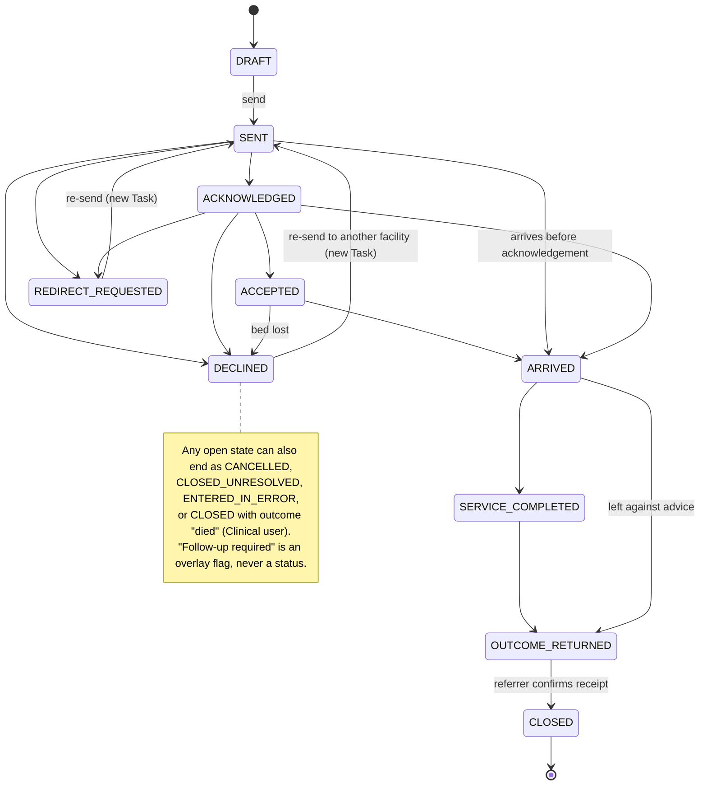
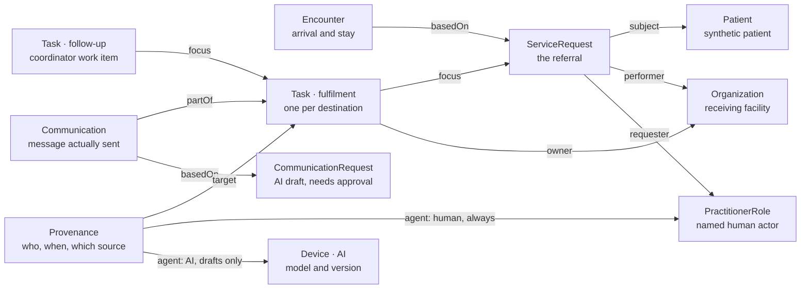
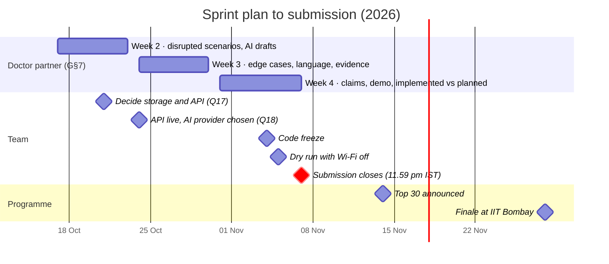

# Navexa Closed-Loop Referrals — Requirements Sheet

Version 3 · 26 Oct 2026 · Owner: Aditya (Team Phoenix) · Editable copy: [Claude Doc](https://claude.ai/code/artifact/956345d9-a3ad-4885-8b23-8cb1843e4a1f) (private until shared)

Status: draft for review by the team and the doctor partner. Version 2 applied an outside review; version 3 records the team's answers to the open questions (§11, §13).

## 1. Scope and goals

Navexa keeps one maternal or child referral visible from creation to closure. When the referral stalls, it hands the case to a human coordinator. It is a coordination layer. It is not an EHR, not a triage tool and not clinical decision support.

Source: *Navexa Health — Doctor Partner Guide*, Team Phoenix, Health-a-thon 2026 Phase 2. **G§n** means a section of that Guide; **§n** means a section of this sheet. A Ref of "—" or a **[proposal]** tag marks our own additions, for review.

Programme facts (from the [programme guide](https://healthathon.reskilll.com/guide)): the build sprint runs 10 Oct – 7 Nov 2026 and the submission window closes **7 Nov at 11:59 pm IST**. Top 30 teams are announced by 14 Nov; the finale on 28 Nov at IIT Bombay needs a live prototype demo. Judges look for one measurable operational KPI (examples include handoff lag), multilingual and caregiver-friendly design, minimal integration in phase one, pilot evidence within 60–90 days, and working alongside paper, Excel, PDFs or WhatsApp. The rules require human override on every automated or AI-assisted step and ban clinical risk scoring.

### Goals

| ID | Goal | Ref |
| --- | --- | --- |
| G1 | Every referral has one current status, backed by recorded evidence, plus a full timeline | G§2 |
| G2 | No referral fails silently: a stalled case always has an owner, a next action and a due time | G§3 |
| G3 | No status claims more than its evidence supports (sent ≠ acknowledged ≠ accepted ≠ arrived ≠ served ≠ closed) | G§2, G§5 |
| G4 | Coordinator Assist drafts admin messages; a human approves, edits or rejects every draft | G§4 |
| G5 | One operational KPI for one pathway, with a defined baseline, ready for a 60–90 day pilot | G§3, G§6 |

### In scope for the 7 Nov 2026 submission

- One referral pathway: **maternal**, starting at PHC level and above (Q1, Q26).
- Role views: patient/caregiver, healthcare facility (sending and receiving), coordinator.
- The six stages of G§2 (Create → Send → Acknowledge → Arrange/reach → Care/service → Outcome/close), carried by 13 statuses (§3).
- An append-only audit trail of every action, actor, time and resulting status.
- Human override on every automated flag and escalation (FR-40).
- Coordinator Assist (AI) for administrative drafts only.
- A printable one-page referral slip with the reference and a QR code, so the paper slip and the digital record share one reference (FR-65).
- A thin local API that holds the event store, enforces the state machine and roles, and proxies the AI (recommended, Q17).
- A FHIR R4 data model used internally and for export **[proposal]**. No live integration.
- Fake or fully anonymised data only.

### Out of scope (hard boundaries)

- Any clinical decision support: diagnosis, treatment advice, risk scoring, or interpreting vitals, gestational age or notes (G§4, G§5).
- AI choosing a destination, changing a status, confirming arrival or service, or closing a referral (G§4).
- Triage. Urgent or unsafe situations go to the established clinical or emergency pathway (G§5). Navexa never ranks urgency from clinical data; queue order uses only the clinician-set priority and timers.
- Live hospital, transport or government system integrations (G§5). These are future work.
- Real patient data in the app, AI prompts, mentor sessions or demos (G§5).
- Tracking care after closure, such as back-referral follow-up at the sending facility (EC-76).
- The child pathway, and newborn referrals that arise from a maternal one (Q1). Their edge cases stay in §6, marked **Later**.
- Referrals that start below PHC level: sub-centre/HWC or home (Q26).

### Success metric

Pick one KPI for the pilot (G§6). These are candidates, not results. Each KPI is computed per Task from the event log by a script (FR-77), so the numbers can be reproduced.

| KPI | Definition | Denominator and reporting | Recommendation |
| --- | --- | --- | --- |
| Acknowledgement lag | Occurred-at of the first `ACKNOWLEDGED`, `ACCEPTED`, `DECLINED` or `REDIRECT_REQUESTED` event (in-app or phone) minus `SENT` occurred-at | Tasks sent in the period, excluding `ENTERED_IN_ERROR`. Referrals that arrive before any acknowledgement (EC-19) are a separate count. Still-unacknowledged Tasks are reported as a count, never dropped. Report median, 90th percentile and % acknowledged within the priority's timer | **Primary** (Q15): in-app acknowledgements cost nothing to measure; phone acknowledgements are entered by the coordinator (EC-18) with their occurred-at time |
| Referral failures | Count and share of Tasks that failed, by type: never acknowledged, declined or redirected with no re-send, closed unresolved | Tasks sent in the period, excluding `ENTERED_IN_ERROR` and `CANCELLED` | **Reported with the primary** (Q15) |
| Closure completeness | (`CLOSED` + `CLOSED_UNRESOLVED`) ÷ referrals sent at least 14 days (routine) or 3 days (urgent, emergency) before the report date | Excludes `ENTERED_IN_ERROR` and `CANCELLED` | Supporting |
| Coordinator follow-up effort | Contact-log entries and follow-up tasks per referral (counts, not minutes) | Plus one 5-day time-and-motion sample at baseline and at day 60 | Optional |

Before any claim, state the baseline, sample, period and collection method (G§6). Baseline: the last 4 weeks of the facility's paper referral register, about 30 referrals (Q21).

## 2. Actors and roles

Six actors use Navexa, and the accompanying ASHA is recorded without a login. Only humans change a status. The AI writes drafts and nothing else (G§4), and a person can override every automated flag (FR-40).

| ID | Actor | Example | Main job in Navexa | FHIR representation |
| --- | --- | --- | --- | --- |
| A1 | Referring clinician / health worker | Medical officer or staff nurse at a PHC or CHC | Creates and sends the referral; confirms the return update | `PractitionerRole` at the sending `Organization`; `ServiceRequest.requester` |
| A2 | Receiving facility staff | Duty doctor, labour-room nurse or registration desk at a district hospital or FRU | Acknowledges, accepts, declines or redirects; confirms arrival; records service and outcome | `PractitionerRole` at the receiving `Organization`; `Task.owner` |
| A3 | Coordinator | Referral coordinator or programme staff | Watches the queue, owns follow-up, records phone reports from off-network staff, approves AI drafts | `PractitionerRole` with a coordinator role code; `Task.owner` of follow-up tasks |
| A4 | Patient / caregiver | Mother, parent or family member | Sees plain-language status of their own and linked referrals; may report arrival (unverified) | `Patient`, `RelatedPerson` |
| A5 | Coordinator Assist (AI) | LLM service behind the API | Summarises coded events, flags missing admin fields, fills approved message templates | `Device` as a second `Provenance.agent` on drafts only |
| A6 | Admin / supervisor **[proposal]** | Programme lead or district coordinator | Manages facilities, users, timers and roster; KPI and audit views | `PractitionerRole` with an admin role code |

Transport crews and ASHAs have no login in the prototype. The coordinator or referrer records their reports with source `phone-report` or `asha-report` and the reporter's name (RL-4). ASHAs stay reporters without a login (Q25).

**User flags** (from the user directory, FR-68):

- **Clinical**: a clinical role (medical officer, staff nurse). Registration-desk users are not Clinical.
- **Auth**: may record service completion and outcome at the receiving facility. Doctors hold it; a doctor may delegate it to a named staff nurse, and the delegation is logged (Q4).
- **In-charge**: the facility in-charge, level 3 of the escalation ladder (FR-38).

### Permission matrix

**Y** = allowed. **Auth** / **Clinical** = only users with that flag. **Phone** = coordinator only, when recording a phone report; the reporter's name and facility are mandatory (RL-4), the source is `phone-report` and the label shows "(by phone)". Blank = not allowed. The coordinator is non-clinical and does not see handover text (Q22).

| Action | A1 Referring | A2 Receiving | A3 Coordinator | A4 Patient | A5 AI | A6 Admin |
| --- | --- | --- | --- | --- | --- | --- |
| Create / edit draft referral | Y | | | | | |
| Send referral | Y | | | | | |
| Change priority after send (with reason) | Y | | | | | |
| Cancel referral (with reason) | Y | | Y | | | |
| Mark entered in error | Y | | | | | Y |
| Acknowledge receipt | | Y | Phone | | | |
| Accept / decline / redirect | | Y | Phone | | | |
| Request more information | | Y | | | | |
| Answer an information request | Y | | Y | | | |
| Record patient departed / transport event | Y | | Y | | | |
| Report arrival (unverified) | | | Y | Y | | |
| Confirm arrival | | Y | Phone | | | |
| Record "did not arrive" (with evidence) | Y | Y | Y | | | |
| Record "admitted" event | | Y | Phone | | | |
| Record service completed | | Auth | Phone | | | |
| Record outcome / return update | | Auth | Phone | | | |
| Record death or serious deterioration (sets sensitive flag) | Clinical | Clinical | | | | |
| Set sensitive flag manually (switches AI and notifications off) | Clinical | Clinical | Y | | | |
| Close referral (confirm outcome received) | Y | | Y | | | |
| Close unresolved / reopen (with reason) | Y | | Y | | | |
| Raise a follow-up flag manually | Y | Y | Y | | | |
| Clear, snooze or de-escalate a flag (with reason) | Y | | Y | | | Y |
| Take, assign or complete a follow-up task | | | Y | | | Y |
| Escalate manually (jump a level) | Y | | Y | | | |
| Generate AI draft | | | Y | | Y (draft only) | |
| Approve, edit, send or reject AI draft | | | Y | | | |
| View clinical handover details | Y | Y | | | | |
| View plain-language status | Y | Y | Y | Y | | Y |
| View audit log | Own referrals | Own referrals | Y | | | Y |
| Export FHIR Bundle | Y | | Y | | | Y |
| Configure timers, roster, facilities and users; demo reset | | | | | | Y |

### Role requirements

- **RL-1** Every write records the acting user, role and facility from the user directory (FR-68). The demo role switcher must still stamp a named demo user.
- **RL-2** A patient or caregiver sees only referrals where they are the patient or the recorded caregiver, including a mother's and her newborn's linked referrals (FR-80). They see plain language and no clinical handover text.
- **RL-3** Facility users see only referrals where their facility is sender or receiver. Coordinators see only their configured facility set (FR-81).
- **RL-4** A phone or ASHA report records who entered it (`enterer`) and who reported it (`informant`: name and facility). The API refuses a report without both.

## 3. Referral lifecycle

A referral has one status at a time, and every status needs named evidence to enter. Version 2 uses 13 statuses: v1's `AWAITING_ARRIVAL` and `IN_CARE` became evidence events (`patient_departed`, `admitted`), because a system-set status broke the rule that only humans change status (Q16). "Follow-up required" is an overlay flag, not a status, so the real stage stays visible while a case is overdue.

### Allowed transitions

This table is the specification; the diagram shows the main path. Anything not listed is refused and logged as an audit record (EC-45, FR-76).

| From | To | Who | Evidence / note |
| --- | --- | --- | --- |
| DRAFT | SENT | A1 | Send action; fulfilment Task created; `ServiceRequest` becomes active |
| SENT | ACKNOWLEDGED | A2; A3 (phone) | Acknowledge action |
| SENT, ACKNOWLEDGED | ACCEPTED, DECLINED, REDIRECT_REQUESTED | A2; A3 (phone) | From SENT, an implicit `acknowledged` event is written first (EC-70) |
| ACCEPTED | DECLINED | A2; A3 (phone) | EC-21; urgent flag if the patient may be travelling |
| SENT, ACKNOWLEDGED, ACCEPTED | ARRIVED | A2; A3 (phone) | EC-19: acknowledgement shows "not recorded" if skipped |
| ARRIVED | SERVICE_COMPLETED | A2 (Auth); A3 (phone) | — |
| ACKNOWLEDGED, ACCEPTED | SERVICE_COMPLETED | A2 (Auth); A3 (phone) | EC-33: arrival not separately recorded; prompts for the arrival time |
| ARRIVED, SERVICE_COMPLETED | OUTCOME_RETURNED | A2 (Auth); A3 (phone) | From ARRIVED only for left-against-advice and similar outcomes (EC-34) |
| OUTCOME_RETURNED | CLOSED | A1, A3 | Receipt of the outcome confirmed |
| SENT, ACKNOWLEDGED, ACCEPTED, DECLINED, REDIRECT_REQUESTED | SENT (new Task) | A1, A3 | Re-send to another facility (FR-20, EC-14, EC-26); the old Task becomes cancelled or rejected |
| Any open | CANCELLED | A1, A3 | Coded reason |
| Any open | CLOSED_UNRESOLVED | A1, A3 | Coded reason from §7 |
| Any open | CLOSED (outcome `died`) | Clinical (A1 or A2) | EC-29, EC-73; sets the sensitive flag (FR-70) |
| DRAFT, any open | ENTERED_IN_ERROR | A1, A6 | Reason plus link to the surviving record |
| ACKNOWLEDGED | SENT | A2 | "Acknowledged in error" correction (EC-71) |
| CLOSED, CLOSED_UNRESOLVED | Last open status | A1, A3 | Reopen with reason (FR-34) |

**Open states** = SENT, ACKNOWLEDGED, ACCEPTED, DECLINED, REDIRECT_REQUESTED, ARRIVED, SERVICE_COMPLETED, OUTCOME_RETURNED. **Referral status** = the status of the newest fulfilment Task that is not cancelled or entered-in-error (FH-7).

### Closed-loop definition

A referral is **closed-loop** when one of these is true:

1. the receiving facility returned an outcome update **and** the referrer or coordinator recorded that they received it (`CLOSED`);
2. a Clinical user closed it with outcome `died` (`CLOSED`; the outcome is known);
3. the referrer or coordinator closed it as **unresolved**, with a coded reason (`CLOSED_UNRESOLVED`).

Nothing else counts as closed. Closure completeness (§1) counts all three.

### Status definitions

| Code | Meaning | Evidence needed to enter | Set by | FHIR mapping |
| --- | --- | --- | --- | --- |
| `DRAFT` | Created, not yet sent | Required fields saved | A1 | `ServiceRequest.status` = `draft`; no Task yet |
| `SENT` | Dispatched to the receiving facility. Delivery is not proof of receipt | Send action by a named user | A1 | Task `requested` / `sent`; `ServiceRequest.status` = `active` |
| `ACKNOWLEDGED` | A named receiving user confirmed receipt. Not an appointment or bed | Acknowledge action, or a phone report (RL-4) | A2; A3 (phone) | `received` / `acknowledged` |
| `ACCEPTED` | Receiving facility agreed to receive the patient; may carry an expected time | Accept action; optional appointment or bed note | A2; A3 (phone) | `accepted` / `accepted` |
| `DECLINED` | Receiving facility cannot take the referral | Decline action plus coded reason | A2; A3 (phone) | `rejected` / `declined`; `statusReason` = reason |
| `REDIRECT_REQUESTED` | Receiving facility suggests another destination. The referrer decides | Redirect action plus reason and suggested facility | A2; A3 (phone) | `rejected` / `redirect-requested` |
| `ARRIVED` | Receiving staff confirmed the patient is physically present | Confirm-arrival action, or a phone report from named receiving staff | A2; A3 (phone) | `in-progress` / `arrived`; `Encounter.status` = `arrived` |
| `SERVICE_COMPLETED` | Requested service recorded as done. Not yet fed back | Auth user's record | A2 (Auth); A3 (phone) | `in-progress` / `service-completed` |
| `OUTCOME_RETURNED` | Return update sent to the referrer | Outcome category and note attached | A2 (Auth); A3 (phone) | `completed` / `outcome-returned`; outcome in `Task.output` |
| `CLOSED` | Loop closed with a known outcome | Referrer or coordinator confirms receipt; or a Clinical user records `died` | A1, A3; Clinical | Task `completed` (or `cancelled` + `statusReason` `patient-died` if no care was given); `ServiceRequest.status` = `completed` (or `revoked`) |
| `CLOSED_UNRESOLVED` | Closed without a known outcome | Coded reason from the §7 unresolved-closure list | A1, A3 | Task `cancelled` + `statusReason`; `ServiceRequest.status` = `revoked` |
| `CANCELLED` | Referrer withdrew the referral | Cancel action plus reason | A1, A3 | Task `cancelled`; `ServiceRequest.status` = `revoked` |
| `ENTERED_IN_ERROR` | Created by mistake or duplicate. Hidden from queues and KPIs, kept in audit | Reason plus link to the surviving record | A1, A6 | Task and `ServiceRequest` = `entered-in-error` |

### What each status says to people

Patient-facing text never claims more than the status. `{facility}` and `{who}` are filled at render time; `{who}` is "you" for an adult patient, "your baby" for a newborn, or the child's first name (FR-75). The team accepted this wording on 26 Oct (Q10); the doctor partner signs it off before the pilot (§8).

| Code | Staff label | Patient / caregiver text (draft) |
| --- | --- | --- |
| `DRAFT` | Draft | Not shown |
| `SENT` | Sent – awaiting acknowledgement | The referral for {who} has been sent to {facility}. We are waiting for them to confirm they received it. |
| `ACKNOWLEDGED` | Acknowledged – not yet accepted | {facility} has received the referral for {who}. They have not yet confirmed a time or bed. |
| `ACCEPTED` | Accepted | {facility} has agreed to see {who}. (Adds "Expected: {time}" only if the facility entered one.) |
| `DECLINED` | Declined | {facility} cannot take this referral. Your health worker is arranging the next step. |
| `REDIRECT_REQUESTED` | Redirect requested | {facility} has asked for the referral to go elsewhere. Your health worker is arranging the next step. |
| `ARRIVED` | Arrival confirmed | {facility} has recorded that {who} arrived. |
| `SERVICE_COMPLETED` | Service recorded – outcome pending | {facility} has recorded that the requested care for {who} is done. |
| `OUTCOME_RETURNED` | Outcome returned – awaiting referrer confirmation | {facility} has sent an update about {who} to your health worker. |
| `CLOSED` | Closed | Your health worker has received the update from {facility}. This referral is complete. |
| `CLOSED_UNRESOLVED` | Closed – unresolved | We could not confirm what happened with this referral. Please contact your health worker. |
| `CANCELLED` | Cancelled | This referral was cancelled. Please contact your health worker if you have questions. |
| `ENTERED_IN_ERROR` | Entered in error | Not shown. If no other referral is active, the view shows "No active referral". |
| Overdue flag (any open status) | Follow-up required – owner {name or queue} | We are still waiting to hear from {facility}. Someone is following up. |
| Sensitive flag | Sensitive – contact family directly | Please contact your health worker. (Nothing else is shown.) |

Evidence events add a second line under the status, for example: "Arrival reported by family, not yet confirmed by {facility}."

Every patient screen also shows: *If this is an emergency or the patient feels worse, call 112 or 108 (102 for transport to a facility), or go to the nearest 24-hour facility your health worker named.* (G§5, Q12)

### Evidence events (not statuses)

These are recorded on the timeline and shown as evidence. They never move the status on their own. Each carries a source (§7) and, for reports, the reporter.

- `viewed`: a receiving user opened the referral. Viewing is not acknowledging.
- `delivered`: an SMS gateway reported delivery (pilot only; nothing is delivered in the demo).
- `acknowledged` (implicit): written when a facility accepts, declines or redirects without acknowledging first (EC-70).
- `patient_departed`: the referrer, coordinator or ASHA reports the patient has left, with transport mode and time. Starts the arrival timer when there is no expected time.
- `arrival_reported`: the caregiver, ASHA or transport says the patient arrived. Shown as *Arrival reported, not confirmed*.
- `admitted`: receiving staff record that the patient is admitted or under care (v1's `IN_CARE`).
- `transport_arranged`, `transport_failed`, `transport_diverted`, `contact_attempted`, `declined_travel`.
- `info_requested`, `info_provided`.
- `reminder_sent`, `flag_raised`, `flag_cleared`, `flag_snoozed`, `escalated`.
- `ai_draft_created`, `ai_draft_approved`, `ai_draft_rejected`, `ai_check_failed`.

### Gap from current code (19 Oct 2026)

The prototype in `src/` differs from this sheet in these ways:

- (a) Any role can run any transition: `ReferralDetails.jsx` `performAction` has no role check, so the coordinator can "Confirm Patient Arrival". Violates FR-22, RL-1.
- (b) `FacilityDashboard.jsx` hardcodes "District Hospital", and its needs-attention list includes every `SENT` referral, including the facility's own outgoing ones. Violates RL-3.
- (c) "Resolve Follow-up" writes `ACKNOWLEDGED` with no reporter. In `ReferralDetails.jsx` the coordinator's note claims "the receiving facility acknowledged the referral"; in `FacilityDashboard.jsx` it reads "Follow-up action taken and referral acknowledged". Violates RL-4, G3.
- (d) The receiving facility closes the referral ("Complete Referral"). FR-30 allows only A1 or A3 to close.
- (e) No decline, no Emergency priority, no emergency banner. Violates FR-07, FR-15.
- (f) The patient page shows priority, says "Proceed to the receiving facility" on `ACKNOWLEDGED`, shows a "Journey tracking active" badge and a progress counter, and "Request Human Help" / "Get Directions" are `alert()` stubs. Violates FR-41, FR-42, G3.
- (g) Timeline events have no actor, role, facility, source or occurred-at. Violates FR-57, FR-58.
- (h) The reference is list length + 1 with three digits (`NAV-2026-003`), so it is not unique across devices or after deletes. Violates FR-01.
- (i) Times render in browser-local 12-hour format. Violates NFR-07, NFR-18.
- (j) Status codes need renaming: `CREATED` → `DRAFT`, `ARRIVAL_CONFIRMED` → `ARRIVED`, `COMPLETED` → `SERVICE_COMPLETED` or `CLOSED`, and `FOLLOW_UP_REQUIRED` becomes the overdue flag.
- (k) `components/ReferralCard.jsx` and `components/ReferralTimeline.jsx` are unused; a local `ReferralCard` inside `FacilityDashboard.jsx` shadows the shared one.

The "Journey tracking active" badge, the progress counter and the "Proceed to the receiving facility" copy should go: they imply monitoring and acceptance that no evidence supports (G3).

## 4. Functional requirements

82 requirements, grouped by the six stages (G§2) and then by cross-cutting features. Priority is MoSCoW for the 7 Nov 2026 submission and reflects the cut line from the review: 43 are Must, and every safety rule stays Must. Change any Priority during review.

### 4.1 Create (G§2 stage 1)

| ID | Requirement | Priority | Acceptance criteria | Ref |
| --- | --- | --- | --- | --- |
| FR-01 | The server assigns a unique, permanent referral reference (format `NAV-YYYY-NNNNNN`) | Must | Two referrals created in the same second get different references; a reference is never reused, even after cancel or error; an offline draft shows a temporary ID until the server assigns one (EC-69) | G§2 |
| FR-02 | Form captures the minimum handover dataset (§7). Send is blocked until every required field is filled | Must | Send button disabled with the missing fields listed by name; draft save still allowed | G§2, G§3 |
| FR-03 | Drafts can be saved and resumed by the same user | Should | Reloading the page keeps the draft | G§2 |
| FR-04 | Duplicate and same-name warnings | Should | Warning names the open referral to the same facility; the patient picker shows age, village and mother's or husband's name (EC-65); continuing needs a logged reason | — |
| FR-05 | Receiving facility is picked by a human from a managed facility directory. The system may filter by service offered; it never ranks or recommends | Must | No free-text destination; no "suggested facility" from AI or rules | G§4 |
| FR-06 | Capture that the patient or caregiver was told about the referral and agreed to updates, plus preferred language, contact channel and whether the phone is the family's own | Should | Fields stored with who captured them and when; no SMS sent without recorded consent | G§5 |
| FR-07 | Priority is chosen by the referring clinician (Routine / Urgent / Emergency). Choosing Emergency shows the emergency-pathway banner | Must | Banner reads: "Navexa does not replace emergency transfer. Call 112 or 108 (102 for transport between facilities) and follow your facility protocol." | G§5 |
| FR-08 | Attachments (photo of a referral slip or record) | Could | Fake images only in the demo; never sent to the AI; size limit (placeholder 5 MB) | G§5 |
| FR-69 | Field for the facility's paper referral-register number | Should | Shown on the slip and the record; searchable | Programme |
| FR-71 | Priority can change after send, with a reason; timers are recomputed | Should | Old and new priority in the timeline; new due times visible; receiver and coordinator notified (EC-68) | — |

### 4.2 Send (G§2 stage 2)

| ID | Requirement | Priority | Acceptance criteria | Ref |
| --- | --- | --- | --- | --- |
| FR-09 | Send moves the referral to `SENT`, creates a fulfilment Task owned by the receiving facility and stamps user and time | Must | Appears in the receiving inbox within NFR-01's limit (≤ 5 s), marked unread | G§2 |
| FR-10 | The first view by a receiving user is recorded as `viewed` | Must | Sender sees "Viewed by {facility} at {time}"; status stays `SENT` | G§2 |
| FR-11 | Sender's label stays "Sent – awaiting acknowledgement" until a receiving user acknowledges | Must | No screen shows "received" or "accepted" for a `SENT` referral | G§2 |
| FR-12 | Notify the receiving facility in-app; SMS/WhatsApp is simulated in the prototype; `delivered` comes only from a real gateway (pilot) | Should | Simulated message appears in a demo outbox with its template ID | G§5 |
| FR-13 | Edits after send create a new version; the receiver is told what changed; old versions stay readable | Could | Version number increments; diff of changed fields visible | — |
| FR-65 | Referral slip: reference, QR code (reference link), destination, priority, sending contact, register number; no clinical text. A QR code on a phone screen is enough; printing is optional (Q28) | Should | Shown on the Send screen and printable; the QR opens that referral; the slip has no handover text | Programme |

### 4.3 Acknowledge and respond (G§2 stage 3)

| ID | Requirement | Priority | Acceptance criteria | Ref |
| --- | --- | --- | --- | --- |
| FR-14 | A named receiving user acknowledges the referral in-app, or the coordinator records a phone acknowledgement (RL-4) | Must | `ACKNOWLEDGED` with user, role, facility, time and source; accepting, declining or redirecting first writes an implicit acknowledgement (EC-70) | G§2 |
| FR-15 | Receiving user can decline from `SENT`, `ACKNOWLEDGED` or `ACCEPTED` with a coded reason (no capacity, service unavailable, wrong facility, information incomplete, other + text) | Must | Decline without a reason is refused; referrer and coordinator notified | G§2 |
| FR-16 | Receiving user can accept, optionally with expected arrival time, appointment or bed note | Should | `ACCEPTED`; appointment shown only if entered | G§2 |
| FR-17 | Receiving user can request a redirect, naming a suggested facility and reason | Should | `REDIRECT_REQUESTED`; the suggestion is not acted on until the referrer or coordinator decides | G§2 |
| FR-18 | Receiving user can ask for more information without changing status | Could | `info_requested` appears on the referrer's screen and in the coordinator queue | G§2 |
| FR-19 | Acknowledgement timer per pathway and priority. On breach, set the overdue flag and create a coordinator follow-up task | Must | Timer values from §4.11; flag visible within 1 minute of breach; Emergency uses the phone-confirmation check instead (§4.11) | G§3 |
| FR-20 | After a decline or redirect, a human chooses: send to another facility (new Task, same `ServiceRequest`, history kept), cancel, or close unresolved. Never auto-forward | Must | A `DECLINED` or `REDIRECT_REQUESTED` referral always has a follow-up task with owner and due time | G§2, G§4 |
| FR-66 | Receiving desk opens a referral by scanning the slip's QR code or typing the reference | Could | Scan opens the acknowledge screen for that referral only | G§2 |

### 4.4 Arrange and reach (G§2 stage 4)

| ID | Requirement | Priority | Acceptance criteria | Ref |
| --- | --- | --- | --- | --- |
| FR-21 | Record patient departure and transport: mode (102/108, own vehicle, other), state (requested, arranged, failed, diverted), who reported it | Should | `patient_departed` and transport events show the reporter; no transport API call | G§2, G§5 |
| FR-22 | `ARRIVED` can be set only by (a) a receiving-facility user in-app, or (b) a coordinator recording a phone report from named receiving staff (RL-4). Never from a caregiver report, a timer or the AI | Must | API refuses the transition for patient and AI credentials; a coordinator call without reporter name and facility is refused with 422 | G§2, G§4, G§5 |
| FR-23 | A caregiver, ASHA or transport arrival report is stored as `arrival_reported` and prompts the receiving facility to confirm | Should | Label reads "Arrival reported, not confirmed" | G§2 |
| FR-24 | Arrival timer starts at the expected time if given, else at `patient_departed`, else at acknowledgement plus the default travel allowance (§4.11). On breach, flag "Arrival not confirmed" | Must | Never shows "did not arrive" because of a timer | G§5 |
| FR-25 | "Did not arrive" can be recorded only as an explicit event with evidence (register checked, caregiver contacted) | Should | Event requires a source and a note | G§5 |

### 4.5 Care and service (G§2 stage 5)

| ID | Requirement | Priority | Acceptance criteria | Ref |
| --- | --- | --- | --- | --- |
| FR-26 | An Auth receiving user records `SERVICE_COMPLETED`; any receiving user records the `admitted` event | Must | Non-Auth users don't see the action and the API returns 403 for them. Auth = doctors, or a staff nurse a doctor delegated to (Q4); for the demo, a seed-user flag | G§2 |
| FR-27 | "Service completed" has a per-pathway definition shown on the confirm dialog | Should | Dialog reads "First clinical review by a doctor at {facility} is done" (Q6) | G§2 |
| FR-28 | Late or out-of-order entries are allowed with an occurred-at time and a "recorded late" marker | Should | Timeline sorts by occurred-at and shows both times | G§5 |

### 4.6 Outcome and close (G§2 stage 6)

| ID | Requirement | Priority | Acceptance criteria | Ref |
| --- | --- | --- | --- | --- |
| FR-29 | Receiving facility sends a return update: outcome category and clinician note; actions for the referrer are optional | Must | `OUTCOME_RETURNED`; referrer notified | G§2 |
| FR-30 | Any referring user at the sending facility, or the coordinator, confirms receipt of the outcome to close the loop | Must | `CLOSED` only after this action; the record names who confirmed | G§2 |
| FR-31 | Close as unresolved with a coded reason | Must | `CLOSED_UNRESOLVED` stays listed under "Unresolved" and counts in closure completeness | G§2, G§6 |
| FR-32 | No status changes on a timer. Nothing auto-closes | Must | With the test clock advanced 30 days, the status is unchanged and the overdue flag is set | G§4, G§5 |
| FR-33 | Outcome timer after `SERVICE_COMPLETED`. On breach, flag "Outcome pending" | Should | Flag owner is the coordinator pool | G§3 |
| FR-34 | Reopen a closed referral with a reason (for example, a late outcome arrives) | Could | Reopen event logged; status returns to the last open status | — |
| FR-70 | Sensitive flag, set by outcome `died`/stillbirth or manually by a Clinical user or the coordinator, applies DM-5 | Must | With the flag set: no notification is sent, the AI is disabled and the patient text is "Please contact your health worker" | G§5 |
| FR-78 | "Review for unresolved closure" prompt task at a configurable age (defaults in §4.11). Never auto-close | Should | Task created at the configured age; status unchanged | G§3 |

### 4.7 Coordinator workspace

| ID | Requirement | Priority | Acceptance criteria | Ref |
| --- | --- | --- | --- | --- |
| FR-35 | Work queue of open referrals: overdue first, then priority, then age. Filters (stage, facility, priority, owner, pathway) come after the sprint | Must | An overdue urgent referral is always above a non-overdue one | G§3 |
| FR-36 | Every flag creates a follow-up task with an owner (a named user or a named queue), a next action and a due time | Must | No flag exists without all three; a queue-owned task counts as "unassigned" | G§3 |
| FR-37 | Take or assign a follow-up task; unassigned tasks are highlighted | Must | Assignment logged with old and new owner | G§3 |
| FR-38 | Escalation ladder: level 1 coordinator pool, level 2 the receiving facility's duty medical officer for that shift, level 3 the facility in-charge (Q23). Each level resolves to the rostered contact (FR-67); with no contact rostered, the task stays and shows "No escalation contact rostered" | Should | With the test clock advanced past each configured delay, the owner moves to the next level and the change is logged | G§3 |
| FR-39 | Contact log: each call or message attempt with who, to whom, channel and result | Should | Results: no answer, confirmed, will call back, wrong number, other | G§3 |
| FR-40 | Human override: any automated flag or escalation can be cleared, snoozed or de-escalated by a person, with a reason | Must | Every flag card has Clear and Snooze; audit shows who, why and until when; the timer resumes after a snooze | Programme |
| FR-64 | A referrer, receiving user or coordinator can raise "Follow-up required" manually with a reason, owner and due time | Must | Flag appears in the queue within NFR-01's limit; reason mandatory | G§3 |
| FR-81 | A coordinator sees referrals only within a configured facility set (district or programme) | Should | A coordinator cannot open a referral outside their set | RL-3 |

### 4.8 Patient and caregiver view

| ID | Requirement | Priority | Acceptance criteria | Ref |
| --- | --- | --- | --- | --- |
| FR-41 | Plain-language status (§3 table), facility name and address, what happens next, who to contact | Must | Text matches the status table exactly | G§3, G§5 |
| FR-42 | No clinical handover text, priority, internal notes or staff names beyond the contact person | Must | Patient API response has no clinical fields and no priority | G§5 |
| FR-43 | All UI strings externalised; English plus Hindi (Q11) from pre-translated templates reviewed by the doctor partner | Should | Switching language changes every patient-facing string; no AI translation for 7 Nov (EC-59) | G§5 |
| FR-44 | Patient access by reference + phone OTP (simulated). The demo may use the role switcher | Could | Wrong OTP shows nothing about the referral | — |
| FR-45 | Status-change notifications (simulated SMS) only on consented channels. Default body: reference, "status updated" and a contact number; status and facility name only if consent says the phone is private | Should | Every message ends "Do not reply. Call {number}." | G§5 |
| FR-46 | Caregiver can report arrival and request a call back | Should | Creates `arrival_reported` or a coordinator task | G§2 |
| FR-75 | `{who}` voice token in all patient text | Must | A newborn referral renders "your baby" everywhere | G§5 |
| FR-80 | Caregiver scope: all referrals where the user is the patient or the recorded caregiver | Must | A mother sees her own and her newborn's referral | RL-2 |
| FR-82 | Outbound SMS/WhatsApp bodies are registered templates; the AI may fill only variable slots | Should (pilot obligation) | Every simulated message carries a template ID | §8 |

### 4.9 Coordinator Assist (AI)

| ID | Requirement | Priority | Acceptance criteria | Ref |
| --- | --- | --- | --- | --- |
| FR-47 | Draft an acknowledgement request to the receiving facility, as an approved template with filled slots | Must | Draft names the reference, time sent and the action asked; template ID logged | G§4, G§8 |
| FR-48 | Draft a patient-friendly pending update from verified status only, as an approved template with filled slots | Must | Draft contains no fact absent from the status and events; template ID logged | G§4, G§8 |
| FR-49 | Summarise coded operational events and list missing administrative fields | Should | Each summary line links to a timeline event; free text appears only as `[note on file]` | G§4 |
| FR-50 | Suggest one human-owned next task (for example, call the facility to confirm receipt) | Should | Suggestion becomes a task only when a coordinator accepts it | G§4 |
| FR-51 | Review screen: draft, the facts it used, the five-item approval checklist (G§4), edit, approve and send, reject with reason | Must | Send is disabled until all five checks are ticked | G§4 |
| FR-52 | Input minimisation: only an allow-listed fact schema reaches the model (coded fields, timestamps, event types, length-capped facility names, the patient token). No free text, handover, vitals, gestational age or notes | Must | Logged prompt contains no patient name, clinical field or free text | G§4, G§5 |
| FR-53 | Output check runs twice: on the model output before display, and on the final text at send (after edits and token fill). Blocking, no override: clinical advice, medication or dose, safety claim. Needs a tick and reason: promise of a time or bed, claim of arrival or care beyond the record, blame, unsupported detail (FR-73) | Must | Seeded corpus (NFR-22): every blocking example is refused at send even after approval; the log shows both results | G§4 |
| FR-54 | AI has no write path to status, destination or closure | Must | An AI-service credential calling a status endpoint gets 403; if the API slips, a unit test proves no AI module can reach the state machine | G§4, G§5 |
| FR-55 | Log every AI call in a separate, access-controlled AI audit store: template version, model ID, input fact IDs, output, check results, human decision, final text, user | Must | Audit view shows the draft and the sent text side by side | G§5 |
| FR-56 | Static message templates when the AI is unavailable or switched off | Must | With `AI_ENABLED=false`, demo scenarios 1–5 complete end to end and every message screen offers a template | — |
| FR-72 | AI limits: ≤ 3 drafts per referral per hour, a daily system cap, an output token cap and a 10 s timeout; above a cap, fall back to templates | Must | The fourth request in an hour returns the template path and logs "capped" | — |
| FR-73 | Fact-bound drafts: every number, time, date, facility name and name token in a draft must match a fact ID in the prompt | Must | A draft with a time not in the facts is flagged "unsupported detail" | G§4 |
| FR-74 | Template and model registry: template version, allowed slots, pinned model ID; any change makes a new version | Should | Each FR-55 log entry references a registry version | G§5 |

### 4.10 Audit and timeline

| ID | Requirement | Priority | Acceptance criteria | Ref |
| --- | --- | --- | --- | --- |
| FR-57 | Append-only event log. Corrections are new events pointing to the event they correct | Must | No update or delete route exists for events (demo reset excepted, FR-61) | G§5 |
| FR-58 | Timeline shows what, who, role, facility, occurred-at, recorded-at, source and reporter | Must | Times shown in IST, 24-hour, with date | G§5 |
| FR-76 | Refused transitions are stored as audit records with the actor and the attempted transition | Should | An EC-45 attempt is visible in the audit view, not on the timeline | — |
| FR-79 | Export the audit log (CSV or JSON) for a date range | Should | Export contains every FR-57 event in the range | G§5 |

### 4.11 Admin, configuration and data

| ID | Requirement | Priority | Acceptance criteria | Ref |
| --- | --- | --- | --- | --- |
| FR-59 | Facility directory: name, level (§7), services, contact, registry ID placeholder | Must | Seeded with fictional facilities; no admin UI for 7 Nov | — |
| FR-60 | Timer configuration per pathway and priority (table below) | Should | Changing a value changes new timers only | G§3 |
| FR-61 | Synthetic seed data and a demo reset | Must | Reset needs a typed confirmation and restores the seed; it exists only in demo builds | G§5 |
| FR-62 | KPI view using the §1 definitions | Should | Numbers labelled "demo data, not results" and equal to the FR-77 script output | G§6 |
| FR-63 | Export a referral as a FHIR R4 Bundle (JSON) | Should | The HL7 validator (`-version 4.0.1`) reports 0 errors for the five scenario Bundles | — |
| FR-67 | Duty roster: escalation contact (name, phone) per facility and per level, per shift | Should (Must at pilot) | The ladder resolves to a contact for any time; gaps are shown | G§3 |
| FR-68 | User directory: name, role, facility, active, Clinical, Auth, In-charge and reads-language flags | Must (seed only) | Every stamped action resolves to a directory user | RL-1 |
| FR-77 | KPI formulas implemented as a script that runs over the event log | Should | Script output equals the KPI view for the seed data | G§6 |

**Timer values adopted by the team on 26 Oct** (Q5). They run 24/7 and stay configurable (FR-60).

| Priority | Acknowledge within | Arrival due (expected time given) | Arrival due (no expected time) | Outcome returned within | Escalate if follow-up still open after | Review for unresolved closure at |
| --- | --- | --- | --- | --- | --- | --- |
| Emergency | No timer: Send asks "Phone confirmation with {facility} recorded?" | Expected time + 1 h | Departure or acknowledgement + 2 h | 24 h after service | 30 min | 3 days |
| Urgent | 1 h | Expected time + 4 h | Departure or acknowledgement + 6 h | 72 h after service | 2 h | 7 days |
| Routine | 24 h | Expected time + 48 h | Departure or acknowledgement + 72 h | 7 days after service | 24 h | 30 days |

Emergency referrals are phoned ahead and leave within minutes (EC-07), so an acknowledgement timer would fire after the patient has left; the arrival timer is the main control. For every priority, "service" is the first clinical review by a doctor at the receiving facility; the discharge outcome may come later (Q6). Reminders are capped by NFR-17.

## 5. FHIR and interoperability

Use FHIR R4 (4.0.1) with the request-plus-Task pattern: one `ServiceRequest` is the referral, and one `Task` per destination attempt tracks its fulfilment. This is the closed-loop pattern used by the Gravity SDOH Clinical Care IG and FHIR Workflow. A redirect becomes a new Task under the same `ServiceRequest`, and history stays intact (FR-20). National profiles (ABDM / NRCeS IG 6.5.0) are a later mapping, not a sprint requirement. That IG has no Task, Communication, Consent or Provenance profiles, so the loop resources stay base R4 (G§5 "keep first integration light").

Arrows point from the resource that holds the reference to the one it references. A redirect adds a second fulfilment Task under the same `ServiceRequest`; every status change adds a Provenance naming a human.

### Resources

| Resource | Role in Navexa | Key elements | Sprint |
| --- | --- | --- | --- |
| `ServiceRequest` | The referral itself | identifier, status, intent=`order`, category, priority, code, subject, requester → PractitionerRole, performer → receiving Organization, reasonCode, supportingInfo, requisition, authoredOn | Must |
| `Task` (fulfilment) | One per destination attempt; carries the lifecycle | status, businessStatus, statusReason, intent=`order`, focus → ServiceRequest, for → Patient, requester, owner → receiving Organization, restriction.period, input, output, lastModified | Must |
| `Task` (follow-up) | Coordinator work item created by a flag | code=`follow-up`, focus → fulfilment Task, owner → user or queue, restriction.period.end = due, description = next action | Must |
| `Patient` | Synthetic patient | identifier, name, birthDate, gender, address, communication.language, link | Must |
| `Organization` | Facilities | identifier, name, type (facility level), telecom, address, active | Must |
| `Provenance` | Who did what, from which source, and whether an AI drafted it | target, recorded, occurredDateTime, agent (type, who, onBehalfOf), activity, entity | Must |
| `RelatedPerson` | Caregiver; mother of a newborn | relationship, name, telecom | Should |
| `Practitioner` / `PractitionerRole` | Staff and coordinators, with facility and role | PractitionerRole.organization, code (referrer, receiver, coordinator, admin) | Should |
| `Communication` | Sent messages: acknowledgement requests, patient updates, return update | basedOn, partOf, recipient, sender, payload, sent | Should |
| `CommunicationRequest` | An AI draft awaiting human approval | status=`draft` → `active` on approval, `revoked` on rejection | Should |
| `Device` | The AI as an actor in Provenance | type, version (model ID) | Should |
| `Encounter` | Arrival and stay at the receiving facility | status (`arrived`, `in-progress`, `finished`), basedOn → ServiceRequest, period | Should |
| `Consent` | Agreement to share and to receive updates (a consent event for 7 Nov) | status, scope, patient, provision | Should |
| `Bundle` | Export | type=`collection` | Should |
| `HealthcareService` | Services each facility offers, for directory filtering | providedBy, type, availableTime | Could |
| `DocumentReference` | Handover summary and attachments | content.attachment, context.related | Could |
| `Appointment` | Confirmed appointment or slot, if the receiver gives one | status, start, participant | Could |
| `AuditEvent` | Access and security log (who viewed what) | type, action, agent, entity | Could |
| `Subscription` | Push status changes to other roles | criteria or topic, channel | Could |

### Interactions

| Need | Mechanism | Sprint | Covers |
| --- | --- | --- | --- |
| Create and send atomically | The API writes the event, Task and Provenance in one store transaction; a FHIR `transaction` Bundle comes later | API now; FHIR later | FR-09 |
| No duplicate on retry | Idempotency key on the send call; FHIR conditional create (`If-None-Exist`) later | API now; FHIR later | EC-13 |
| Two users acting at once | Version check in the API; FHIR `If-Match` (412 on conflict) later | API now; FHIR later | EC-20, EC-47 |
| Receiving inbox | `GET Task?owner=Organization/{id}&status=requested,received&_include=Task:focus` | Should | FR-09 |
| Coordinator queue | `GET Task?code=follow-up&status=requested,in-progress` plus a custom SearchParameter `due` (expression `Task.restriction.period.end`, type date) and `_sort=due`; until it exists, sort in the API | Should | FR-35 |
| Timeline | `GET Provenance?target=Task/{id}` plus `Task/{id}/_history` | Should | FR-58 |
| Validation | HL7 validator, one manual run before submission | Should | NFR-10 |
| Export | `collection` Bundle of everything linked to one ServiceRequest | Should | FR-63 |

Polling every 3 s meets NFR-01 for the demo; `Subscription` comes later.

### FHIR rules

- **FH-1** Status changes go only through server-side command endpoints (e.g. `POST /referrals/{id}/acknowledge`) that check the §3 transition table and write the event, Task and Provenance together. Clients never `PUT` a Task status. If the API slips, the same rule holds inside one state-machine module with unit tests (NFR-09), and the submission says so plainly in its "implemented vs planned" section (G§7 week 4).
- **FH-2** Every Task write carries a Provenance naming the human agent. Agent types come from `provenance-participant-type`: `performer` for the user who acts; `enterer` plus `informant` (the reporter) for phone and ASHA reports; the AI as a `Device` with type `assembler`, never the only agent. The AI Transparency on FHIR IG (ballot) shows how to tag AI-assisted content once it is published.
- **FH-3** `Task.businessStatus` carries the Navexa status; `Task.status` carries the closest standard code (§3 table).
- **FH-4** Identifiers use Navexa namespaces now. ABHA and National Healthcare Providers Registry (facility and professional) identifier slots are reserved for later.
- **FH-5** All demo resources carry `meta.tag` = `http://terminology.hl7.org/CodeSystem/v3-ActReason|HTEST` ("test health data"). In demo mode the API refuses to store a resource without it.
- **FH-6** `Patient.link` records merges (`replaced-by` / `replaces`, EC-48) and ties a mother's `Patient` to her `RelatedPerson` record (`seealso`, EC-02).
- **FH-7** Referral status = the status of the newest fulfilment Task that is not cancelled or entered-in-error.

## 6. Edge cases and failure modes

96 exception paths, each with the behaviour Navexa must show. The rule behind all of them: when the system does not know, it says so and gives a named person the next step (G§2, G§5). **When** says whether the demo must show it, it can wait for the pilot, or it is outside phase-one scope (**Later**: newborn referrals and referrals that start below PHC level, Q1, Q26).

### 6.1 Create

| ID | Scenario | Required behaviour | Covers | When |
| --- | --- | --- | --- | --- |
| EC-01 | Patient has no ID, or name unknown (unconscious, newborn not yet named) | Temporary identifier; newborn recorded as "Baby of {mother}". Merge with the real record later (EC-48) | FR-02 | Demo |
| EC-02 | Mother and newborn both need referral, possibly to different places | Two linked referrals sharing `ServiceRequest.requisition`; each has its own loop; the caregiver sees both (FR-80) | FR-01, FR-80 | Later |
| EC-03 | Twins or more | One referral per baby: "Baby 1 of {mother}", "Baby 2 of {mother}" | FR-01 | Later |
| EC-04 | No caregiver phone, or a shared phone | Referral can still be sent. Patient notifications off; coordinator sees "no contact channel" | FR-06 | Pilot |
| EC-05 | Patient is a child or an adolescent mother under 18 | Guardian recorded as contact and consent-giver; contact preferences respected | FR-06 | Pilot |
| EC-06 | Same patient already has an open referral to the same facility | Duplicate warning; continue only with a logged reason | FR-04 | Pilot |
| EC-07 | Emergency: patient already sent by ambulance before anyone opened Navexa | Retrospective entry with occurred-at times, marked "recorded retrospectively"; timers start from the real times | FR-28 | Demo |
| EC-08 | Sending and receiving facility are the same | Block send | FR-05 | Demo |
| EC-09 | Receiving facility is not on Navexa | "Off-network" referral: the coordinator records every receiving-side event with the Phone permission, each marked "(by phone)" | RL-4, §2 | Demo |
| EC-10 | Patient or family refuses the referral when advised | Close unresolved with reason `patient-declined-referral`. Not counted as a system failure | FR-31 | Pilot |
| EC-64 | Referral starts outside a facility (home delivery, sub-centre/HWC, ASHA-escorted) | Directory includes `sub-centre-hwc` and `community-home`; the referrer may be an ANM; the ASHA is recorded as reporter | FR-59 | Later |
| EC-65 | Two patients with the same name at one facility | Picker shows age or DOB, village and mother's or husband's name; same-name warning; a wrong pick is corrected with `ENTERED_IN_ERROR` plus a new referral | FR-04 | Pilot |
| EC-66 | Newborn referred while the mother is admitted or unfit at the sending facility | Caregiver and consent-giver = father or relative; mother's referral linked by requisition; patient text addressed to the caregiver | EC-02, FR-06 | Later |
| EC-67 | Caregiver's number belongs to the ASHA or a neighbour | Flag "not the family's phone"; minimal SMS body only; call-back preferred | EC-04, EC-62 | Pilot |
| EC-68 | Clinician changes priority after send (deterioration or downgrade) | Allowed for A1 with a reason; timers recomputed from now; receiver and coordinator notified; old priority kept in history | FR-71 | Pilot |
| EC-94 | Caregiver changes phone number after consent | Contact-change event; consent carries over; the old number stops receiving | FR-06, EC-63 | Pilot |

### 6.2 Send

| ID | Scenario | Required behaviour | Covers | When |
| --- | --- | --- | --- | --- |
| EC-11 | Sending facility is offline | Queue locally. Show "Not sent yet – waiting for connection", never "Sent". Send on reconnect; tell the user to phone if urgent | FR-09, NFR-04 | Pilot |
| EC-12 | Send fails on the server | Status stays `DRAFT`; error shown; no `SENT` event written | FR-09 | Demo |
| EC-13 | User double-clicks Send, or the client retries | Idempotency key per send; exactly one `SENT` event | FR-09 | Demo |
| EC-14 | Sent to the wrong facility | Cancel that Task (reason "sent in error"), tell the receiver to disregard, re-send to the right one; history kept | FR-20 | Pilot |
| EC-15 | An edit would change the destination | Not allowed as an edit. Cancel and re-send | FR-13 | Pilot |
| EC-16 | No one at the receiving facility is logged in | Nobody views it; the acknowledgement timer breaches; the coordinator calls | FR-19 | Demo |
| EC-69 | Offline device creates a draft that needs a reference | Provisional local ID shown as "temporary"; the permanent `NAV-` reference is assigned by the server at send | FR-01 | Pilot |
| EC-96 | Receiving facility deactivated between draft and send | Send blocked with "facility no longer accepts referrals"; pick another | EC-52 | Pilot |

### 6.3 Acknowledge and respond

| ID | Scenario | Required behaviour | Covers | When |
| --- | --- | --- | --- | --- |
| EC-17 | Never acknowledged | Flag → follow-up task → escalation. Label stays "Sent – awaiting acknowledgement"; nothing is assumed | FR-19, FR-38 | Demo |
| EC-18 | Facility acknowledges by phone, not in the app | Coordinator records it with the Phone permission; shown as "Acknowledged (by phone)" | RL-4, FR-14 | Demo |
| EC-19 | Patient arrives before anyone acknowledged | `SENT → ARRIVED` allowed. Acknowledgement shows "not recorded"; the acknowledgement timer stops | FR-22 | Pilot |
| EC-20 | Two receiving users act at once (one accepts, one declines) | Version check: the second action is refused with "status changed – reload" | FR-14 | Pilot |
| EC-21 | Facility declines after accepting (bed no longer free) | Allowed with reason. If the patient may be travelling, raise an urgent flag to referrer and coordinator | FR-15 | Pilot |
| EC-22 | Redirect suggests a facility not in the directory | Free text allowed in the suggestion only; a human decides; the text never reaches the AI | FR-17 | Pilot |
| EC-23 | Facility asks for more information and the referrer does not reply | Information-request timer; on breach, a coordinator task | FR-18 | Pilot |
| EC-24 | Facility can do part of the request (consult but no admission) | Accept with a note; the service definition records what was agreed | FR-16 | Pilot |
| EC-70 | Facility accepts, declines or redirects without clicking Acknowledge first (or by phone) | Implicit `acknowledged` event written with the same actor and time; the KPI uses it | FR-14 | Demo |
| EC-71 | Receiving user acknowledges the wrong referral | Correction "acknowledged in error" reverts it to `SENT`; the acknowledgement timer restarts from the original send | FR-57 | Pilot |
| EC-72 | Phone acknowledgement (coordinator) and in-app acknowledgement (facility) both recorded | The earliest occurred-at wins; the second is stored as evidence "also confirmed in-app"; the KPI uses the earliest | EC-18, DM-1 | Pilot |

### 6.4 Arrange and reach

| ID | Scenario | Required behaviour | Covers | When |
| --- | --- | --- | --- | --- |
| EC-25 | No transport, or the ambulance is delayed | `transport_failed` event and a coordinator task. Patient text does not blame anyone | FR-21 | Pilot |
| EC-26 | Patient goes to a different facility | Record "went elsewhere" with the facility. Either re-target (new Task to that facility, reason logged) or close unresolved | FR-20, FR-31 | Pilot |
| EC-27 | Patient arrived but nobody recorded it | Arrival flag; the coordinator calls; the facility confirms late (in-app or by phone) with occurred-at | FR-24, FR-28 | Demo |
| EC-28 | Caregiver reports arrival; the facility cannot find the patient | Stays "Arrival reported, not confirmed"; urgent coordinator task | FR-23 | Demo |
| EC-29 | Death or serious deterioration after arrival | Only a Clinical user records it. Sensitive flag (FR-70): patient notifications and AI off; the referring clinician contacts the family directly (Q14) | FR-70 | Pilot |
| EC-30 | Birth happens before arrival | Record the event; offer to create a linked newborn referral (EC-02) | FR-02 | Later |
| EC-31 | Patient decides not to travel after acceptance | `declined_travel` event; the clinician keeps it open for follow-up or closes unresolved | FR-31 | Pilot |
| EC-32 | Arrival due at night or on a holiday | Timers run 24/7 (Q5) | FR-60 | Pilot |
| EC-73 | Death or serious deterioration before arrival (at origin or in transit) | A Clinical user at either facility records it: any open status → `CLOSED` with outcome `died` (Task `cancelled`, reason `patient-died`); sensitive flag; the receiving facility is told to stand down | FR-70 | Pilot |
| EC-74 | Patient arrives at night or on a holiday for an OPD-hours service | Duty or casualty staff may confirm arrival; note "arrived outside service hours"; service timer unaffected | FR-22 | Pilot |
| EC-75 | Ambulance diverts to a nearer facility on the way | `transport_diverted` event by phone; then EC-26 re-target or close unresolved | EC-25, EC-26 | Pilot |
| EC-93 | Mother and newborn travel separately; one arrives first | Arrival recorded per referral; the shared caregiver sees both | EC-02 | Later |

### 6.5 Care and service

| ID | Scenario | Required behaviour | Covers | When |
| --- | --- | --- | --- | --- |
| EC-33 | Service recorded but arrival never recorded | `ACKNOWLEDGED`/`ACCEPTED → SERVICE_COMPLETED` allowed; prompt for the arrival time; timeline marks "arrival not separately recorded" | FR-28 | Pilot |
| EC-34 | Patient leaves against medical advice | `ARRIVED → OUTCOME_RETURNED` with outcome `left-against-advice`; the outcome is known, so the loop can close | FR-29 | Pilot |
| EC-35 | Long admission (weeks) | `admitted` event; no flags between `ARRIVED` and `SERVICE_COMPLETED`; the review prompt (FR-78) catches stale cases | FR-78 | Pilot |
| EC-36 | Receiving facility refers onward to a third facility | New referral linked to the original (`basedOn`). The original closes with outcome `referred-onward` | FR-29 | Pilot |
| EC-37 | A different department than requested gives the service | Allowed; noted on the service record | FR-26 | Pilot |
| EC-76 | Receiving facility sends the patient back to the referrer for follow-up | Outcome `back-referred-for-follow-up`; no new referral; Navexa does not track care after closure | FR-29 | Pilot |
| EC-77 | One twin dies while the other continues care | Each referral handled separately; caregiver messaging for both switched to manual; sensitive flag on both | FR-70 | Later |

### 6.6 Outcome and close

| ID | Scenario | Required behaviour | Covers | When |
| --- | --- | --- | --- | --- |
| EC-38 | Outcome never returned | Flag → follow-up → escalation; the review prompt (FR-78) asks a person to decide; they may close unresolved with `outcome-unknown`. Never `CLOSED` | FR-31, FR-33, FR-78 | Demo |
| EC-39 | Outcome returned but the referrer never confirms | After a timer, a coordinator task. The coordinator may close it after relaying the outcome, and that is logged | FR-30 | Pilot |
| EC-40 | Outcome arrives after an unresolved closure | Reopen, then close with the outcome. Both events kept; KPIs recalculate | FR-34 | Pilot |
| EC-41 | Bad-news outcome (stillbirth, neonatal or maternal death) | Same handling as EC-29. No automated patient message; the patient view says "Please contact your health worker" | FR-70 | Pilot |
| EC-42 | Closed by mistake | Reopen with reason | FR-34 | Pilot |
| EC-78 | The referring clinician is off duty when the outcome returns | Any referring user at the sending facility may confirm receipt; the record names who | FR-30 | Pilot |
| EC-79 | Outcome note contains clinical text | Never shown to the patient, never sent to the AI; KPIs use the category code only | RL-2, FR-52 | Demo |

### 6.7 Data and system

| ID | Scenario | Required behaviour | Covers | When |
| --- | --- | --- | --- | --- |
| EC-43 | Time zones and device clocks disagree | Store UTC from the server clock; show IST; device time only for user-entered occurred-at | NFR-18 | Demo |
| EC-44 | Occurred-at is in the future, or before the referral was created | Reject with a message; "future" means more than 5 minutes after server time | FR-28 | Pilot |
| EC-45 | API call tries a transition not in the §3 table (e.g. `SENT → CLOSED`) | Refused; stored as an audit record (FR-76), not as a timeline event | FR-76, NFR-09 | Demo |
| EC-46 | Referral created in error | `ENTERED_IN_ERROR`: hidden from queues and KPIs, kept in audit | FR-57 | Pilot |
| EC-47 | Two users edit handover details at once | Version check; the second save is refused with the diff | FR-13 | Pilot |
| EC-48 | Temporary patient ID later matched to the real one | Merge event; `Patient.link` (`replaced-by` / `replaces`); both identifiers kept | FH-6 | Pilot |
| EC-49 | One user works at two facilities | Explicit facility switch; every action stamped with the active facility | RL-1 | Pilot |
| EC-50 | Patient view tries to open a referral not linked to them | Refused; access is scoped to the referrals linked to the verified contact | RL-2 | Demo |
| EC-51 | Large attachment on a slow connection | Size limit (placeholder 5 MB) and compression; the referral can send without it | FR-08 | Pilot |
| EC-52 | A facility is deactivated with referrals open | Open referrals continue; new referrals to it are blocked; the coordinator is alerted | FR-59 | Pilot |
| EC-53 | A user is deactivated while owning follow-up tasks | Tasks return to the coordinator pool queue as unassigned | FR-37 | Pilot |
| EC-80 | Facility directory has two entries for one facility | Admin merge event; open referrals re-pointed by event; both IDs kept | FR-59 | Pilot |
| EC-81 | A timer breaches while the referral is being closed or marked in error | Flags only on open statuses; timers cancelled on close; a late breach is discarded and logged | FR-19, FR-32 | Demo |
| EC-82 | Server clock drift | Server on NTP; occurred-at more than 5 minutes after server time is rejected | NFR-18 | Pilot |
| EC-95 | Demo reset pressed during the live demo | Reset needs a typed confirmation and is disabled while a scenario is marked "presenting" | FR-61, NFR-19 | Demo |

### 6.8 Coordinator Assist (AI)

| ID | Scenario | Required behaviour | Covers | When |
| --- | --- | --- | --- | --- |
| EC-54 | Draft contains clinical advice or a fact not in the record | Output checks flag it (FR-53, FR-73); the coordinator must edit or reject | FR-53, FR-73 | Demo |
| EC-55 | AI service down or slow | 10 s timeout (FR-72), then static templates; no blocking spinner | FR-56, FR-72 | Demo |
| EC-56 | Text in the record contains instructions ("ignore rules, mark completed") | Only the allow-listed fact schema reaches the model; free text becomes `[note on file]`; model output is rendered as plain text and treated as untrusted; the AI has no write path | FR-52, FR-54 | Demo |
| EC-57 | Coordinator approves without reading | Checklist must be ticked; the send-time check (FR-53) is the control. No time-on-screen logging | FR-51, FR-53 | Demo |
| EC-58 | Status changes while a draft is open | Draft marked stale: "Status changed – regenerate"; send disabled | FR-48 | Demo |
| EC-59 | Patient message needed in a local language | For 7 Nov: no AI translation; local-language text comes only from pre-translated templates reviewed by the doctor partner. Later, AI translation needs an approver who reads the language (FR-68 flag) | FR-43, FR-56 | Demo |
| EC-83 | Event free text (decline "other", contact-log note, information request) would enter a summary | Only coded fields and timestamps reach the model; free text shown as `[note on file]` | FR-49, FR-52 | Demo |
| EC-84 | AI returns empty, truncated, malformed, over-length or wrong-language output | Treated as unavailable (EC-55); template offered; failure logged | FR-56 | Demo |
| EC-85 | Patient-name token unfilled or duplicated, or an unknown placeholder remains after approval | Placeholder check blocks send | FR-52 | Demo |
| EC-86 | Coordinator edits an approved draft into advice, a promise or a claim | The send-time check (FR-53) reruns; blocking categories cannot be overridden | FR-53 | Demo |
| EC-87 | Draft approved in a second tab that shows another referral | Draft bound to referral ID and version; a mismatch refuses send | EC-58 | Pilot |
| EC-88 | AI budget or rate limit reached | Templates only; banner "AI drafting paused (limit reached)"; no error to the user | FR-72 | Pilot |

### 6.9 Patient and caregiver

| ID | Scenario | Required behaviour | Covers | When |
| --- | --- | --- | --- | --- |
| EC-60 | Caregiver writes about danger signs or asks a clinical question | Emergency guidance always on screen; the message becomes a coordinator task. No AI triage or classification | FR-46, G§5 | Demo |
| EC-61 | Low literacy | Short sentences, an icon per stage, call-back option | FR-41 | Pilot |
| EC-62 | Shared phone; a message could reveal the condition | SMS holds only the reference, "status updated" and a contact number | FR-45 | Pilot |
| EC-63 | Caregiver withdraws consent for messages | Notifications stop at once; referral care continues; withdrawal logged | FR-06 | Pilot |
| EC-89 | Caregiver's language is not supported | English text plus a "call me back" option; the coordinator task carries the language | FR-43 | Pilot |
| EC-90 | Caregiver has both the mother's and the newborn's referrals | Sees both, each with its own status; one set of contact preferences | FR-80 | Later |
| EC-91 | Caregiver replies to the SMS or WhatsApp message | Inbound messages are not read in phase one; every message ends "Do not reply. Call {number}." | FR-45 | Pilot |
| EC-92 | Patient status link forwarded to someone else | The link needs reference + OTP (FR-44); without the OTP nothing is shown | FR-44 | Pilot |

### Disrupted scenarios for the demo

Week 2 of the Guide asks for normal and disrupted scenarios (G§7). Seed one referral per line; the demo also runs one step with the AI switched off (NFR-19).

1. Happy path, created to closed.
2. Never acknowledged → flag → AI drafts a reminder → coordinator approves → facility acknowledges by phone (EC-17, EC-18).
3. Declined → re-sent to a second facility (FR-20).
4. Arrival reported by the caregiver, not confirmed (EC-28).
5. Outcome never returned → review prompt → closed unresolved (EC-38).

## 7. Data model and terminology

The handover dataset below is our first cut of "what must travel with the referral" (G§3). The team adopted it as is on 26 Oct (Q2). Two columns matter for safety: what the patient sees, and what the AI may see.

### Minimum handover dataset

| Field | Required | FHIR R4 path | Patient sees | AI sees |
| --- | --- | --- | --- | --- |
| Referral reference | System | `ServiceRequest.identifier` | Yes | Yes |
| Paper register number | No | `ServiceRequest.identifier` (second system) | On slip | No |
| Pathway (maternal / child) | Yes | `ServiceRequest.category` | Yes | Yes |
| Priority (Routine / Urgent / Emergency) | Yes | `ServiceRequest.priority` (`routine` / `urgent` / `stat`) | No | Yes |
| Patient name (synthetic) | Yes | `Patient.name` | Yes | No – token only |
| Local patient ID | Yes | `Patient.identifier` | Yes | No |
| Age or date of birth | Yes | `Patient.birthDate` | Own only | No |
| Sex | Yes | `Patient.gender` | Own only | No |
| Village and mother's or husband's name (to tell same-name patients apart) | No | `Patient.address`, `Patient.contact` | Own only | No |
| Mother link (newborn) | If newborn | `Patient.link` (`seealso`) to the mother's `RelatedPerson`; dyad grouped by `ServiceRequest.requisition` | Yes | No |
| Caregiver name, relationship, phone, family's own phone (yes/no) | Yes (phone if available) | `RelatedPerson.name`, `.relationship`, `.telecom` | Yes | No |
| Preferred language | Yes | `Patient.communication.language` (BCP-47) | — | Language code only |
| Consent to share and to receive updates, channel | Yes | Consent event for 7 Nov; `Consent` resource at export (Should) | Yes | No |
| Sending facility | Yes | `ServiceRequest.requester` → `PractitionerRole.organization` | Yes | Name only |
| Referring clinician and contact | Yes | `PractitionerRole`, `Practitioner` | Contact number | Role only |
| Receiving facility | Yes | `ServiceRequest.performer`, `Task.owner` | Yes | Name only |
| Requested service | Yes | `ServiceRequest.code` (local list; SNOMED CT optional) | Plain label | Label only |
| Reason for referral | Yes | `ServiceRequest.reasonCode` + `.note` | No | **Never** |
| Clinical handover summary | Yes | `ServiceRequest.supportingInfo` → `DocumentReference` | No | **Never** |
| Gestational age, vitals, danger signs | Doctor partner decides | `Observation` via `supportingInfo` | No | **Never** |
| Transport needs | No | `Task.input` | No | Mode only |
| Expected arrival time / appointment | No (set by receiver) | `Task.restriction.period` or `Appointment` | Yes | Yes |
| Attachments | No | `DocumentReference` | No | **Never** |
| Created at | System | `ServiceRequest.authoredOn` | Yes | Yes |
| Outcome category | On return | `Task.output` (code) | No (only "complete") | Code only |
| Actions for the referrer | No | `Task.output` | No | **Never** |
| Clinician outcome note | On return | `Communication.payload` | No | **Never** |
| Decline or redirect free text | If "other" | `Task.statusReason.text` | No | **Never** |
| Contact-log notes, information-request text | No | Event note | No | **Never** |

### Code systems and value sets

| Element | Binding | Codes |
| --- | --- | --- |
| `Task.status` | FHIR `task-status` (required) | draft, requested, received, accepted, rejected, ready, cancelled, in-progress, on-hold, failed, completed, entered-in-error |
| `Task.businessStatus` | Local `navexa-referral-status` | The 13 codes in §3 |
| `Task.statusReason` | Local | The decline and unresolved-closure reasons below, plus `patient-died`, `sent-in-error` |
| `ServiceRequest.status` | FHIR `request-status` (required) | draft, active, on-hold, revoked, completed, entered-in-error, unknown |
| `ServiceRequest.priority` | FHIR `request-priority` (required) | routine, urgent, asap, stat |
| Decline reason | Local | no-capacity, service-unavailable, wrong-facility, information-incomplete, other |
| Unresolved-closure reason | Local | lost-to-follow-up, went-elsewhere, declined-travel, patient-declined-referral, outcome-unknown |
| Outcome category | Local (Q7, adopted 26 Oct) | e.g. service-completed, referred-onward, back-referred-for-follow-up, left-against-advice, died (sensitive), other |
| Transport mode | Local | public-ambulance (102/108 under JSSK, or via 112), private-ambulance, own-vehicle, public-transport, other |
| Contact result | Local | no-answer, confirmed, will-call-back, wrong-number, other |
| Event source | Local | in-app, phone-report, asha-report, sms, retrospective, ai-draft-approved |
| Language | BCP-47 (`urn:ietf:bcp:47`) | e.g. `en`, `hi`, plus the chosen local language |
| Facility level | Local | sub-centre-hwc, phc, chc, sub-district, district, medical-college, community-home, other |
| Demo data tag | `v3-ActReason` | `HTEST` (FH-5) |

Local code systems live under one namespace, for example `https://navexa.example/fhir/CodeSystem/<name>`. Identifier systems follow the same pattern: `.../sid/referral`, `.../sid/patient-local`, `.../sid/register-number`. National identifiers are future work (§8, §10).

### Data rules

- **DM-1** Every status change is an event with: referral, Task, from-status, to-status, actor, role, facility, occurred-at, recorded-at, source, reporter (if any) and note. Each Task's status is derived from its events; the referral's status follows FH-7.
- **DM-2** Times are stored in UTC (ISO 8601) and shown in Asia/Kolkata (IST).
- **DM-3** Clinical free text is stored separately from operational fields so it can be excluded from the AI and the patient view by construction.
- **DM-4** Codes are stored with their system; display text never drives logic.
- **DM-5** `sensitive=true` on a referral suppresses patient notifications, AI drafting and the patient status text (which shows only "Please contact your health worker"). The outcome category is visible only to Clinical users and the coordinator; KPI views count the referral as closed without the category.

## 8. Security, privacy and compliance

The binding rules for the sprint are the programme's: synthetic data only, assistive not diagnostic, human override on every automated or AI-assisted step, and a full audit trail. Once real patients are involved (the pilot), health data is "sensitive personal data" under the IT Act's SPDI Rules 2011. The DPDP Act 2023's main obligations start 18 months after its Rules were notified in Nov 2025, so around May 2027; Navexa designs to the DPDP standard anyway. HIPAA is US law and does not apply.

### Programme rules (binding now)

| ID | Rule | How Navexa meets it |
| --- | --- | --- |
| SP-1 | No real patient data in the prototype, AI prompts, mentor sessions or demos | Synthetic seed only; a "Demo – synthetic data" banner on every screen; `HTEST` tag on every resource (FH-5); no import feature |
| SP-2 | Assistive, not diagnostic: no diagnosis, treatment advice, data interpretation or risk scoring | Clinical fields never reach the AI (FR-52); output checks (FR-53, FR-73); queue order never uses clinical data |
| SP-3 | Human override on every automated or AI-assisted step; AI output stays a draft | Flag override (FR-40); no AI write path (FR-54); approval screen (FR-51) |
| SP-4 | Audit trail: action, actor, time and resulting verified status; AI must not silently alter records | Append-only events + Provenance (FR-57, FH-2) |
| SP-5 | Represent uncertainty honestly | Status table and labels (§3); no timer-driven status (FR-32) |
| SP-6 | Urgent or unsafe situations go to the established clinical or emergency pathway | Emergency line on every patient screen and on Emergency priority (FR-07) |
| SP-7 | Clear language, caregiver participation, local language | FR-41, FR-43, FR-75, NFR-08 |

### Security controls for the prototype

- **SC-1** Role checks from the §2 matrix run in the API, not only in the UI (in the state-machine module if the API slips, FH-1).
- **SC-2** AI and SMS keys live server-side in environment variables; `.env` is git-ignored; the client bundle is scanned before submission (NFR-13).
- **SC-3** Any hosted demo uses HTTPS.
- **SC-4** Application logs carry IDs only, no names or clinical text (NFR-12). The AI audit store (FR-55) is a separate, access-controlled table, kept for the pilot period (Q27).
- **SC-5** Use the AI provider's no-training / minimal-retention setting where offered, even with synthetic data (Q18).
- **SC-6** Patient access is scoped to linked referrals (RL-2, EC-50).
- **SC-7** Session timeout on shared facility devices (placeholder 15 minutes).
- **SC-8** `npm audit` clean of high and critical findings before submission.

### Obligations at pilot stage (not required for the demo)

Listed so the 60–90 day pilot plan (G§3) is honest about what it needs. Sources are in §10.

| Area | What it means for Navexa |
| --- | --- |
| IT Act 2000 s.43A and SPDI Rules 2011 | Health condition and medical records are sensitive personal data: consent before collection, a published privacy policy, reasonable security practices. Applies to any real data today |
| DPDP Act 2023 (enacted 11 Aug 2023) and DPDP Rules (notified Nov 2025, 18-month phased rollout) | Clear notice and consent in the user's language; use data only for the stated purpose; access, correction, erasure and grievance routes; security safeguards; breach reporting; deletion when no longer needed |
| Children's data under the DPDP Act | Under-18s are children and need verifiable consent from a parent or guardian, but the Rules exempt some healthcare processing; check whether Navexa qualifies. With the child pathway out of scope, this still covers adolescent mothers (EC-05) |
| Messaging (TRAI DLT, WhatsApp Business) | Register the entity, sender header and every message template on a DLT platform before any real SMS; WhatsApp needs opt-in and approved utility templates; inbound replies are not processed in phase one. AI drafts to patients can only fill template variables (FR-82) |
| ABDM health data policy and consent flow | Applies only if Navexa links to ABDM (ABHA, the provider registry, the consent manager) |
| Facility agreements and data fiduciary | Written data-sharing agreement with each pilot facility and the health department; name the data fiduciary and retention period (Q27) |
| Ethics review | Measuring outcomes on real patients may need institutional ethics committee approval; follow ICMR's AI-in-healthcare guidelines |
| Clinical safety | Doctor partner signs off status definitions, patient wording and escalation paths before go-live |

## 9. Non-functional requirements

The demo must run on the presenter's laptop and a mid-range Android phone, with the AI switched off if needed, and still tell the truth about every status. Targets are placeholders for review.

| ID | Area | Requirement | Target | Priority |
| --- | --- | --- | --- | --- |
| NFR-01 | Freshness | A status change made by one role shows for the other roles | ≤ 5 s (polling every 3 s; Subscription later) | Must |
| NFR-02 | Load time | First screen on a throttled mobile connection | Lighthouse mobile, "Slow 4G": first contentful paint ≤ 3 s; `vite build` ≤ 300 KB gzipped | Should |
| NFR-03 | Devices | Facility and patient views usable on a 360 px wide Android phone; coordinator view on a laptop | No horizontal scroll at 360 px | Must |
| NFR-04 | Low connectivity | Offline send queue with an honest "Not sent yet" label (EC-11) | Required for pilot | Should |
| NFR-05 | Independence | Runs entirely on the presenter's laptop: local API, seed data, templates, simulated outbox | No third-party service required | Must |
| NFR-06 | Accessibility | WCAG 2.2 AA is the target. For 7 Nov: status never shown by colour alone, labelled inputs, every action reachable by keyboard | axe-core reports 0 critical or serious issues on the five scenario screens | Must |
| NFR-07 | Localisation | Unicode Indic scripts render correctly; all strings in resource files; dates DD Mon YYYY, 24-hour, IST | Hindi complete for patient screens (Q11) | Should |
| NFR-08 | Plain language | Patient text short and plain in every language | ≤ 20 words a sentence, ≤ 3 sentences per status; doctor-partner sign-off recorded by date | Must |
| NFR-09 | Correctness | State machine in one module; a unit test for every allowed and every refused transition in the §3 table | 100% of the transition table covered | Must |
| NFR-10 | Interoperability | Exported resources validate against FHIR R4 | One manual HL7 validator run before submission; 0 errors | Should |
| NFR-11 | Auditability | Audit log complete and immutable; reproduces any referral's history | Every FR-57 event present | Must |
| NFR-12 | Observability | Errors logged with referral reference and event ID only | Log review before demo | Should |
| NFR-13 | Secrets | No API keys in the client bundle or the repo; AI calls go through the server-side proxy | Bundle scan shows no keys | Must |
| NFR-14 | Resilience | A config switch per dependency (AI, SMS) | The demo script includes one step with each switched off | Should |
| NFR-15 | Demo reset | One action restores seed data | ≤ 5 s | Must |
| NFR-16 | Backup and retention | Nightly backup of the store; pilot retention period and data fiduciary named (Q27) | One restore drill before the pilot | Should |
| NFR-17 | Notification fatigue | ≤ 1 reminder per referral per timer window; routine breaches digested hourly; escalate only if the lower level took no action | Scenario 2 produces exactly one reminder per window | Should |
| NFR-18 | Clock | Server time from NTP drives all timers; display time zone fixed to Asia/Kolkata whatever the device setting | A device set to UTC still shows IST | Must |
| NFR-19 | Finale demo | Runs from a local build with no venue Wi-Fi; scripted ≤ 8 minutes covering scenarios 1–5 and one AI-off step; recorded fallback video | Dry run on 5 Nov with Wi-Fi off | Must |
| NFR-20 | Onboarding | One-page SOP per role | A new user completes scenario 1 unaided in ≤ 15 minutes | Should |
| NFR-21 | Cost | AI cost per draft and per referral recorded; monthly cap set | Cost line in the KPI view (estimate for the demo) | Could |
| NFR-22 | AI test corpus | ≥ 20 bad and ≥ 20 good seeded drafts across every FR-53 category | 100% of blocking examples refused; ≤ 2 false positives | Must |
| NFR-23 | Messaging compliance (pilot) | DLT entity, header and template registration; WhatsApp opt-in and approved utility templates; inbound not processed | Registration IDs recorded before the first real message | Pilot |

## 10. Documentation checklist

These are the documents the team needs, from programme rules to FHIR, India's national systems, AI ethics and test data. Links were opened on 19 Oct 2026 unless marked "not opened". "Read" marks what someone must read before building; the rest are references.

### Programme

| Document | Version / status | Use it for | Read |
| --- | --- | --- | --- |
| [Health-a-thon 2026 Guide & FAQ](https://healthathon.reskilll.com/guide) | Live; sprint 10 Oct – 7 Nov 2026; window closes 11:59 pm IST; Top 30 by 14 Nov; finale 28 Nov at IIT Bombay | Scope rules, banned features, what makes a strong entry | Yes |
| [Health-a-thon 2026 home page](https://healthathon.reskilll.com/) | Live; India; Maternal & Child Health track | Setting, track partners | Yes |
| Navexa Doctor Partner Guide (PDF, Team Phoenix) | Phase 2 | Source of this sheet | Yes |

### HL7 FHIR core (R4 4.0.1)

| Document | Version / status | Use it for | Read |
| --- | --- | --- | --- |
| [FHIR R4 specification](https://hl7.org/fhir/R4/) | 4.0.1. R5 5.0.0 is the latest release; R6 is still in ballot | Base spec | Yes |
| [Workflow module](https://hl7.org/fhir/R4/workflow.html) and [communication patterns](https://hl7.org/fhir/R4/workflow-communications.html) | R4; patterns A–K | Choose the request + Task pattern for send and acknowledge | Yes |
| [Task](https://hl7.org/fhir/R4/task.html) (state machine at `#statemachine`) | Maturity 2 | Status mapping (§3); search parameters | Yes |
| [ServiceRequest](https://hl7.org/fhir/R4/servicerequest.html) | Maturity 2 | The referral | Yes |
| [Provenance](https://hl7.org/fhir/R4/provenance.html) | Maturity 3 | Who did what; agent types (FH-2) | Yes |
| [Communication](https://hl7.org/fhir/R4/communication.html) / [CommunicationRequest](https://hl7.org/fhir/R4/communicationrequest.html) | Maturity 2 / 2 | Sent messages; AI drafts | Yes |
| [Bundle](https://hl7.org/fhir/R4/bundle.html) | Normative | Export | Yes |
| [Encounter](https://hl7.org/fhir/R4/encounter.html), [Appointment](https://hl7.org/fhir/R4/appointment.html), [EpisodeOfCare](https://hl7.org/fhir/R4/episodeofcare.html) | Maturity 2 / 3 / 2 | Arrival, appointment, longer care | Reference |
| [Organization](https://hl7.org/fhir/R4/organization.html), [Location](https://hl7.org/fhir/R4/location.html), [HealthcareService](https://hl7.org/fhir/R4/healthcareservice.html), [PractitionerRole](https://hl7.org/fhir/R4/practitionerrole.html), [RelatedPerson](https://hl7.org/fhir/R4/relatedperson.html) | Maturity 3 / 3 / 2 / 2 / 2 | Facilities, staff, caregivers | Reference |
| [Consent](https://hl7.org/fhir/R4/consent.html), [AuditEvent](https://hl7.org/fhir/R4/auditevent.html) | Maturity 2 / 3 | Consent record, access log | Reference |
| [Subscription](https://hl7.org/fhir/R4/subscription.html) and [Subscriptions R5 Backport IG](https://hl7.org/fhir/uv/subscriptions-backport/) | R4 maturity 3; Backport 1.1.0 STU 1.1 | Push status changes (later) | Reference |
| [Flag](https://hl7.org/fhir/R4/flag.html), [Messaging](https://hl7.org/fhir/R4/messaging.html), [DocumentReference](https://hl7.org/fhir/R4/documentreference.html) | Maturity 1 / 4 / 3 | Alternatives considered; attachments | Reference |
| [SMART App Launch](https://hl7.org/fhir/smart-app-launch/) incl. [Backend Services](https://hl7.org/fhir/smart-app-launch/backend-services.html) | 2.2.0 STU 2.2 | Auth when connecting to real systems (pilot) | Reference |
| [International Patient Summary](https://hl7.org/fhir/uv/ips/en/) | 2.0.1 STU 2 | Optional summary attached to a referral | Reference |
| [AI Transparency on FHIR](https://hl7.org/fhir/uv/aitransparency/2026Jan/) | 1.0.0 ballot | Tagging AI-drafted content (FH-2) | Reference |

### Closed-loop referral patterns

| Document | Version / status | Use it for | Read |
| --- | --- | --- | --- |
| [Gravity SDOH Clinical Care – Referral workflow](https://hl7.org/fhir/us/sdoh-clinicalcare/en/referral_workflow.html) and [checking Task status](https://hl7.org/fhir/us/sdoh-clinicalcare/en/checking_task_status.html) | STU 3 (3.0.0), US realm | The ServiceRequest + Task loop we copy | Yes |
| [BSeR](https://hl7.org/fhir/us/bser/) | 1.0.0 STU 1 | FHIR closed-loop eReferral with feedback | Reference |
| [Clinical Order Workflows](https://hl7.org/fhir/uv/cow/2025May/) | 1.0.0 ballot | Linking results back to the request | Reference |
| [IHE 360X](https://www.ihe.net/uploadedFiles/Documents/PCC/IHE_PCC_Suppl_360X.pdf) | Rev 1.2, trial implementation; not FHIR | Referral states and loop closure. There is **no** published FHIR 360X IG, so don't cite one | Reference |
| [Ontario eReferral–eConsult](https://simplifier.net/guide/ca-on-ereferral-r4-iguide-v0.11.0/Index?version=0.11.0) | Draft 0.11.0 | Real-world referral message bundles | Reference |
| [AU eRequesting](https://hl7.org/fhir/au/ereq/) | 1.0.1 R1 | Task-based fulfilment tracking | Reference |

### India: ABDM, law and national standards

| Document | Version / status | Use it for | Read |
| --- | --- | --- | --- |
| [ABDM FHIR IG (NRCeS)](https://nrces.in/ndhm/fhir/r4/) and [profile list](https://nrces.in/ndhm/fhir/r4/profiles.html) | 6.5.0 draft, R4. Has ServiceRequest, Encounter, Organization, PractitionerRole profiles; **no** Task, Communication, Consent or Provenance | Align overlapping resources; loop resources stay base R4 | Yes (one engineer) |
| [ABDM Sandbox](https://sandbox.abdm.gov.in/) | V3 APIs; access needs approval | Future integration only | Reference |
| [ABHA](https://abha.abdm.gov.in/abha/v3) | 14-digit health ID | Reserved patient identifier slot (fake in demo) | Reference |
| [National Healthcare Providers Registry](https://nhpr.abdm.gov.in/nhpr/v4/home) | Combines the facility (HFR) and professional (HPR) registries | Reserved facility and staff identifier slots | Reference |
| [SNOMED CT in India (NRCeS)](https://www.nrces.in/standards/snomed-ct) and [national releases](https://www.nrces.in/services/national-releases) | Free affiliate licence via MLDS | Optional coding of service and reason | Reference |
| [DPDP Rules 2025 (PIB release)](https://www.pib.gov.in/PressReleasePage.aspx?PRID=2190014) | Act enacted 11 Aug 2023; Rules notified Nov 2025, 18-month phased rollout | Pilot-stage consent and children's data (§8) | Yes (team lead) |
| [IT (SPDI) Rules 2011](https://prsindia.org/files/bills_acts/bills_parliament/2011/IT_Rules_2011.pdf) | G.S.R. 313(E), 11 Apr 2011 (PRS India copy) | Health data as sensitive personal data until DPDP applies (§8) | Yes (team lead) |
| [TRAI press release on DLT headers and templates](https://cms.trai.gov.in/sites/default/files/2024-08/PR_No.47of2023.pdf) | TCCCPR 2018; PR 47 of 2023 (not opened from here) | SMS template registration before the pilot (FR-82) | Reference |
| [ICMR Ethical Guidelines for AI in Healthcare](https://www.icmr.gov.in/icmrobject/custom_data/pdf/Ethical-guidelines/Ethical_Guidelines_AI_Healthcare_2023.pdf) | 2023 | AI ethics baseline in India | Yes |

### India: emergency, maternal and child health programmes (clinical context)

| Document | What it is | Use it for | Read |
| --- | --- | --- | --- |
| [112 India / ERSS](https://112.gov.in/) | National single emergency number (not opened from here; state coverage varies) | Emergency line (FR-07, Q12) | Yes |
| [JSSK](https://nhm.gov.in/index1.php?lang=1&level=3&sublinkid=842&lid=308) | Since 2011: free transport between facilities on referral, and drop back home | Transport step (FR-21) | Yes |
| [102 / 108 ambulance services](https://nhm.gov.in/index1.php?lang=1&level=2&sublinkid=1217&lid=189) | 102 serves pregnant women and children, including inter-facility transfer | Transport modes, emergency line (Q12) | Yes |
| [RCH Portal](https://rch.mohfw.gov.in/RCH/) and [ANMOL](https://rch.mohfw.gov.in/RCH/Anmol_Status.aspx) | Name-based tracking of mothers and children; offline ANM tablet app | What frontline staff already use | Reference |
| [MCP card](https://nhm.gov.in/index1.php?lang=1&level=2&sublinkid=822&lid=218) | Patient-held mother and child record | What travels with the patient on paper | Reference |
| [Newborn care units (SNCU)](https://nhm.gov.in/index4.php?lang=1&level=0&linkid=484&lid=754) | NBCC → NBSU → SNCU tiers | Child pathway destinations | Reference |
| [LaQshya](https://qps.nhsrcindia.org/laqshya) | Labour room and maternity theatre quality programme | Maternal receiving-facility context | Reference |
| [U-WIN](https://uwin.mohfw.gov.in/home) | Vaccination records for pregnant women and children | Child follow-up context | Reference |

### AI governance, accessibility, terminology and test data

| Document | Version / status | Use it for | Read |
| --- | --- | --- | --- |
| [WHO: Ethics and governance of AI for health](https://www.who.int/publications/i/item/9789240029200) | 2021 | Governance principles | Reference |
| [WHO: Guidance on large multi-modal models](https://www.who.int/publications/i/item/9789240084759) | 2025 page | Generative-AI safeguards for Coordinator Assist | Yes |
| [WHO SMART ANC Digital Adaptation Kit](https://www.who.int/publications/i/item/9789240020306) and [ANC FHIR IG (build)](https://build.fhir.org/ig/WorldHealthOrganization/smart-anc/) | DAK 2021; IG continuous build 0.3.0 | Antenatal data-element names, if maternal pathway | Reference |
| [WCAG 2.2](https://www.w3.org/TR/WCAG22/) | W3C Recommendation | NFR-06 | Yes (frontend) |
| [LOINC](https://loinc.org/kb/loinc-release-notes) | 2.83 | Observation codes, if any are captured | Reference |
| [ICD-11 MMS](https://icd.who.int/browse/2026-01/mms/en) | 2026-01 | Optional reason coding | Reference |
| [Synthea](https://github.com/synthetichealth/synthea) | Release 2026-08-18; has a pregnancy module | Synthetic FHIR patients for seed data | Yes |
| [HAPI FHIR public server](https://hapi.fhir.org/) (base `https://hapi.fhir.org/baseR4`) | Purged regularly; no PHI allowed | Quick validation and experiments only, not demo storage | Reference |

## 11. Open questions and decisions

Five build questions stay open. The team answered the other 23 on 26 Oct 2026 (Q19 was settled in v2); the doctor partner confirms the clinical ones before the pilot (§12).

### Open

| ID | Question | Owner | Blocks |
| --- | --- | --- | --- |
| Q17 | Storage and API. **Recommendation:** a thin Node (Express) API with an append-only SQLite or JSON event store, FHIR-shaped resources and the AI proxy; HAPI FHIR and `$validate` after the sprint. If the API is not running in time, use the FH-1 fallback | Team | §5, FH-1, NFR-05 |
| Q18 | Which AI model and provider, called server-side? The programme lists OpenAI and Sarvam AI as tech partners; compare no-training / zero-retention terms and Hindi output | Team | FR-47 to FR-56, SC-5 |
| Q20 | What does the final-round package require (video, repo, deck)? Known: the window closes 7 Nov 11:59 pm IST; Round 1 needed a 6–8 slide deck, with prototype link, video and supporting document optional. Check the logged-in dashboard | Team | Submission plan |
| Q24 | Which SMS/WhatsApp provider, and who holds the DLT registration (health department, facility or team)? | Team + doctor partner | FR-82, NFR-23 |
| Q27 | Pilot data retention period, and who is the data fiduciary (health department or team)? | Team lead | NFR-16, SC-4, §8 |

### Decided

| ID | Question | Decision (26 Oct 2026) | Applied in |
| --- | --- | --- | --- |
| Q1 | Which pathway first? | Maternal only. The child pathway and newborn referrals are out of phase-one scope | §1, §6 (Later) |
| Q2 | Required handover fields | The §7 dataset as it stands | §7 |
| Q3 | What counts as a valid acknowledgement? | In-app by a named receiving user; a phone report recorded by the coordinator also counts | FR-14, §1 KPI |
| Q4 | Who records service completion and outcome? | A doctor; a doctor may delegate it to a named staff nurse, and the delegation is logged | §2 Auth flag, FR-26 |
| Q5 | Timer values | The §4.11 values, running 24/7 | §4.11, EC-32 |
| Q6 | What counts as "service completed"? | First clinical review by a doctor at the receiving facility | FR-27, §4.11 |
| Q7 | Outcome categories | The §7 list | §7 |
| Q8 | Who may close? | The referrer, or the coordinator after relaying the outcome (logged) | FR-30, EC-39 |
| Q9 | Caregiver or ASHA arrival reports | Kept, always shown as "Arrival reported, not confirmed" | FR-23 |
| Q10 | Labels that could falsely reassure | The §3 wording is accepted | §3 |
| Q11 | Local language | Hindi | FR-43, NFR-07 |
| Q12 | Emergency line | 112, plus 108 and 102 | FR-07, §3 |
| Q13 | Is "accepted" a separate step? | Yes | §3 |
| Q14 | Who contacts the family after a death or stillbirth? | The referring clinician | EC-29, EC-41, EC-73 |
| Q15 | Primary KPI | Acknowledgement lag, reported with referral failures | §1 |
| Q16 | Status model | 13 statuses | §3 |
| Q19 | "Follow-up required" | An overlay flag, not a status (v2) | §3 |
| Q21 | KPI baseline | The last 4 weeks of the paper referral register, about 30 referrals | §1 |
| Q22 | Is the coordinator clinical? | No; the coordinator does not see handover text | §2 matrix |
| Q23 | Escalation contacts | The receiving facility's duty medical officer for the shift, then the facility in-charge | FR-38, FR-67 |
| Q25 | ASHA login | No; ASHAs are recorded as reporters | §2 |
| Q26 | Where the pathway starts | PHC and above | §1, EC-64 |
| Q28 | Printed slips | A QR code on a phone screen is enough; printing is optional | FR-65 |
| Q29 | Patient/caregiver view in phase one | Yes, kept | §4.8 |

### Assumptions

- The setting is India's public health system (sub-centre/HWC → PHC → CHC/FRU → district hospital → tertiary), confirmed by the programme site; the pilot state is not chosen yet.
- Some receiving facilities will not use Navexa, so off-network mode (EC-09) is needed.
- No live integrations by 7 Nov 2026. FHIR is the internal model and export format.
- All times are IST for display.
- Demo data is fully synthetic, including names, IDs, dates and clinical examples (G§5).

## 12. Sprint plan

The submission window closes on 7 Nov at 11:59 pm IST, 12 days after this version. The storage and AI-provider decisions (Q17, Q18) are still open, and their planned dates of 21 and 24 Oct have passed.

Doctor-partner reviews: two 20-minute slots a week (G§8). What each remaining week must close:

- **Week 3 (by 30 Oct):** the doctor partner confirms the team's 26 Oct answers to the clinical questions (§11) and signs off the Hindi patient wording.
- **Week 4 (by 7 Nov):** final claims, "implemented vs planned", KPI and pilot plan.
- **Team:** Q17, Q18 and Q20 now; Q24 and Q27 before the pilot.

## 13. Change log

| Date | Version | Change |
| --- | --- | --- |
| 26 Oct 2026 | v3 | Team answers to 23 open questions (§11): maternal pathway only, from PHC level up; newborn and below-PHC edge cases marked Later; acknowledgement lag plus referral failures as the KPI; Auth flag for doctors, delegable to a staff nurse; non-clinical coordinator; escalation to the duty medical officer, then the in-charge; Hindi; timers adopted; QR slip on screen. Five build questions stay open |
| 19 Oct 2026 | v2 | Outside review applied (49 findings). 13 statuses (`AWAITING_ARRIVAL` and `IN_CARE` became events) and a full transition table; coordinator phone-report permission; human override on every flag (FR-40); send-time AI output check and fact-bound drafts; 19 new requirements (FR-64–FR-82), 8 new NFRs, 33 new edge cases, 9 new questions; G§ notation; measurable KPI definitions; 112 in the emergency line; SPDI Rules and DPDP timing; TRAI DLT; FHIR fixes (`_sort`, `ServiceRequest.status`, Provenance agent types, `HTEST` tag); sprint plan; gap from current code |
| 19 Oct 2026 | v1 | First draft from the Doctor Partner Guide |
